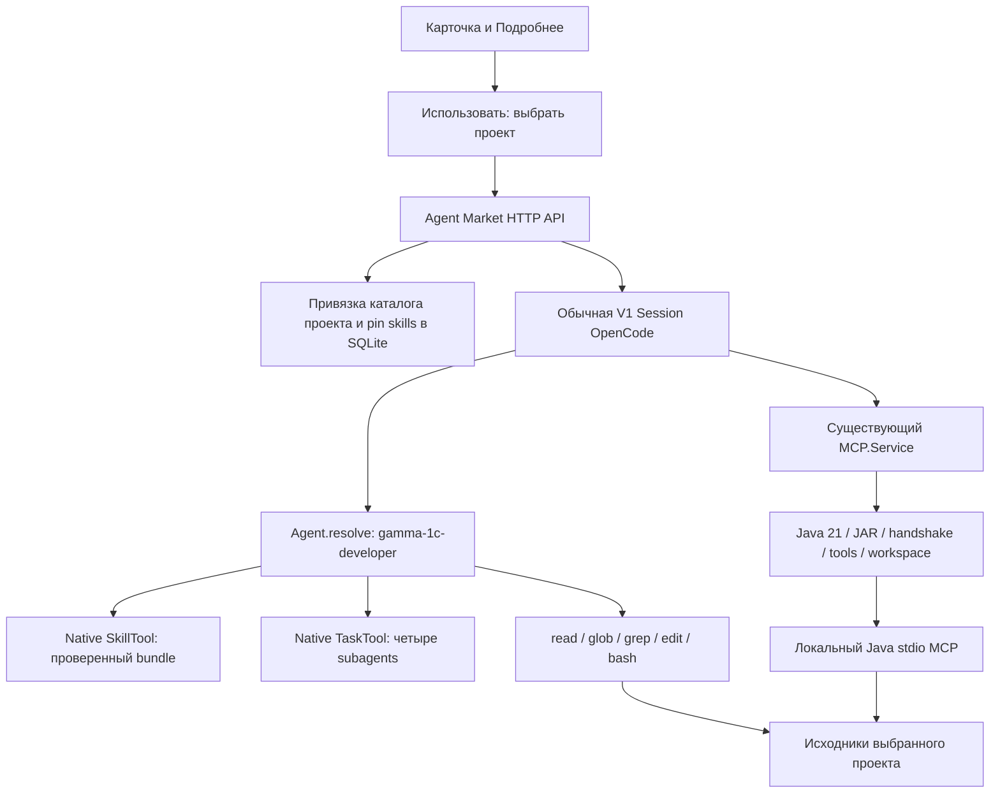

# «1С Разработчик» в Gamma

Проверено 9 октября 2026 года. ID маркета: `1c-developer`, runtime name: `gamma-1c-developer`. Категория фильтра — «Разработка», специализация карточки — «Разработка / Бизнес».

## Результат и границы

Добавлен профиль с 30 skills, Python-генераторами/валидаторами, ресурсами БСП, четырьмя нативными subagents и бесплатным локальным BSL Language Server MCP. Это дополнение существующего V1 runtime OpenCode; отдельного agent runner нет. В маркете теперь **16 видимых карточек**: прежние 15 и новый специалист. Четыре внутренние роли не являются отдельными карточками.

Проверены реальные процессы Python и Java, реальные MCP-вызовы и браузерный путь до сессии. Без платформы 1С доступны исходники, генерация Designer XML и статический анализ. Сборка бинарных CF/CFE/EPF/ERF, проверка информационной базы, исполнение запросов и бизнес-тесты не реализованы и не имитируются.

Рабочее окружение сервера Gamma необходимо настроить по разделу ниже. Проверка в изолированном тестовом окружении не означает, что Java/JAR/Python уже настроены в пользовательском или production-сервере. Существующие серверы приложения не перезапускались; пользовательские проекты не изменялись.

Предыдущий [AGENTS_MARKET_AUDIT.md](AGENTS_MARKET_AUDIT.md) описывает состояние **до этой реализации**.

## Архитектура



| Компонент                                                               | Реализация                                                                                                                                   |
| ----------------------------------------------------------------------- | -------------------------------------------------------------------------------------------------------------------------------------------- |
| Карточка, происхождение, требования, роли                               | [gamma-agent-market/catalog.json](gamma-agent-market/catalog.json), запись `1c-developer`                                                    |
| Основной системный промпт                                               | [profiles/1c-developer.json](gamma-agent-market/profiles/1c-developer.json), `prompt`                                                        |
| Поля `skillBundle`, `mcp`, `leader`, `hidden`; схема диагностики        | [packages/schema/src/agent-market.ts](packages/schema/src/agent-market.ts), `Profile`, `Runtime`                                             |
| Проверка manifest, SHA-256, запрет traversal/symlink ресурсов           | [packages/core/src/agent-market/catalog.ts](packages/core/src/agent-market/catalog.ts), `bundle`, `config`                                   |
| Применение к проекту, транзакция, существующий session flow             | [packages/core/src/agent-market.ts](packages/core/src/agent-market.ts), `apply`                                                              |
| Выбор источников skills по активному профилю                            | [packages/core/src/skill-market.ts](packages/core/src/skill-market.ts), `sources`                                                            |
| Runtime permissions и состав помощников                                 | [packages/opencode/src/agent/agent.ts](packages/opencode/src/agent/agent.ts), `marketAgent`, `resolve`                                       |
| Обнаружение skills и подстановка путей                                  | [packages/opencode/src/skill/index.ts](packages/opencode/src/skill/index.ts), `add`, `current`                                               |
| Java/JAR, проверка workspace, границы файлов, свежесть индекса          | [packages/opencode/src/mcp/bsl.ts](packages/opencode/src/mcp/bsl.ts), `configuration`, `verify`, `validateCall`, `fingerprint`, `refresh`    |
| Подключение, изоляция, закрытие MCP при смене профиля                   | [packages/opencode/src/mcp/index.ts](packages/opencode/src/mcp/index.ts), `current`, `refreshProfile`                                        |
| Проверка перед реальным MCP-вызовом, общая для обычных tools и codemode | [packages/opencode/src/mcp/catalog.ts](packages/opencode/src/mcp/catalog.ts), `guard`, `convertTool`                                         |
| HTTP catalog/apply/check                                                | [packages/opencode/src/server/routes/instance/httpapi/agent-market.ts](packages/opencode/src/server/routes/instance/httpapi/agent-market.ts) |
| UI диагностики                                                          | [packages/app/src/components/agent-runtime.tsx](packages/app/src/components/agent-runtime.tsx), используется в карточке и `ProjectAgent`     |

### Что происходит при «Использовать»

1. Существующий picker выбирает или создаёт проект. Новый агент применяется через прежний POST `product/projects/:project/active-agent`; сохраняются optimistic version, confirmation и idempotency receipt.
2. Backend проверяет профиль, bundle и разрешения skills. Bundle является частью агента: публичный Skill Market остаётся закрытым. Пользователю не предлагается подключить его как отдельный пакет старого маркета.
3. В SQLite сохраняются ID/revision агента и pin `1c-development@gamma-1`. Создаётся обычная V1 Session. Повтор запроса с тем же request ID не создаёт дубликат.
4. MCP runtime обнаруживает активный профиль и пробует подключиться. Отсутствие Java/JAR не мешает созданию сессии, но не даёт инструментов MCP.
5. UI открывает сессию. `Agent.resolve` применяет системный промпт и пересечение разрешений профиля и проекта. Модель/провайдер остаются выбранными в Gamma; отдельной привязки к Claude нет.
6. Skills загружаются по запросу native SkillTool. Создание/редактирование файлов выполняется native tools и скриптами через bash с обычным запросом разрешения.

**В проект не копируются** `.claude`, `.opencode/agents`, `opencode.json`, JAR, весь набор skills или credentials. Исходники создаются только при выполнении конкретной задачи. Bundle читается из поставки Gamma. Выбор сохраняется между сессиями; после смены агента последующие сообщения старых чатов тоже используют текущий профиль, как в исходном Agent Market. Одновременно активен один основной профиль; четыре помощника работают в том же каталоге через native TaskTool.

Интеграция относится к **V1**. V2 SessionRunner не получил автоматического применения market profiles; существующие ограничения V2 не скрыты. Перенос такого механизма на V2 — отдельная работа.

## Источники, версии и лицензии

Все четыре репозитория клонированы во временный каталог; сторонние install/bootstrap-скрипты не запускались. Зафиксированы commits, а не плавающие ветки.

| Источник                                                                                                   | Зафиксированная версия                                                                       | Лицензия и использование                                                                                                                                             |
| ---------------------------------------------------------------------------------------------------------- | -------------------------------------------------------------------------------------------- | -------------------------------------------------------------------------------------------------------------------------------------------------------------------- |
| [Desko77/claude-code-skills-1c](https://github.com/Desko77/claude-code-skills-1c)                          | `4d56644ddb643951058f1e0a0a0059a677dd5785`                                                   | MIT; 28 выбранных skills, Python-порты, references/assets, два связанных справочника из `rules`. Сохранены copyright Desko77 и Nick Shirokov в `LICENSE-Desko77.md`. |
| [brake71/1c-ssl-skills](https://github.com/brake71/1c-ssl-skills)                                          | `4f7b7281e1350eba997beb8d0bf092cc2a34e5fc`                                                   | MIT; один skill `bsp`, его references и `bsp_api.py`; лицензия `LICENSE-brake71`. Справочник относится к БСП 3.1.11.                                                 |
| [1c-syntax/bsl-language-server](https://github.com/1c-syntax/bsl-language-server/releases/tag/v1.1.0-rc.6) | `v1.1.0-rc.6`, tag commit `52a38118b07d6ef2779d46595f349ebf8fd5e8bc`, опубликован 2026-10-02 | LGPL-3.0-or-later; отдельный неизменённый Java-процесс. Java-код и JAR не включены в исходники Gamma. Это prerelease; MCP экспериментальный.                         |
| [Arman-Kudaibergenov/1c-ai-development-kit](https://github.com/Arman-Kudaibergenov/1c-ai-development-kit)  | `92d389edfb7a13c0799065e3865b9488ce019f2d`                                                   | AGPL-3.0; изучена архитектура по README. Код, промпты, skills и ресурсы не перенесены.                                                                               |
| Gamma                                                                                                      | Новая локальная реализация                                                                   | Основной промпт, четыре роли, skill `1c-environment`, MCP bridge и тесты.                                                                                            |

Upstream branch BSL при исследовании: `0e43799635bfad9ad70c006415b6eb3de4c07f89`; для запуска выбран именно release artifact rc.6. Документация: [MCP mode](https://1c-syntax.github.io/bsl-language-server/dev/features/McpMode/). Требование Java 21 и параметры запуска проверены также по исходникам release tag.

SHA-256 официального `bsl-language-server-1.1.0-rc.6-exec.jar`:

```text
bf07373101c3f41d5e164c296f8ab06c0c39b8fbd5d21e34eddd48cb581b4357
```

Хеш скачанного файла совпал с digest release asset GitHub. Python-зависимости: стандартная библиотека и `lxml==6.0.2`; для тестов создан отдельный временный venv. Runtime-зависимости JS-пакетов не добавлялись.

### Адаптация и ресурсы

Поставка: [gamma-agent-market/bundles/1c-development](gamma-agent-market/bundles/1c-development), примерно 3.8 MB. `manifest.json` перечисляет **30 skills и 195 файлов** с SHA-256; manifest отдельно закреплён в `gamma-agent-market/files.json`. Полный список файлов является машинно-проверяемой спецификацией поставки.

- Frontmatter нормализован под native SkillTool: `name`/`description`. Claude-specific `allowed-tools` и аргументы slash commands не используются как права OpenCode.
- PowerShell-варианты и upstream evals не поставляются. Выбраны Python-порты; их scripts, reference/references, assets, JSON-схемы и соседние валидаторы сохранены.
- `{{SKILLS_ROOT}}` заменяется на абсолютный путь к проверенному bundle; `{{PYTHON}}` — на `GAMMA_1C_PYTHON` или `python3`. Native SkillTool также возвращает base directory для относительных references.
- Ресурсы bundle разрешены для чтения native tools; edit/write запрещены. Общий запрет проекта имеет приоритет. Bash остаётся `ask`: это разрешения OpenCode, **не OS sandbox**; подтверждённая shell-команда технически может выполнять операции с правами процесса.
- Исправлено повторное добавление namespace при переиспользовании frontmatter cache: `add` больше не меняет `md.data.name`. Это предотвращает имена вида `1c-development:1c-development:bsp`.
- В code-review и query-optimization заменены инструкции вызывать отсутствующие AI-EDT/Напарник/validate_query. Коммерческие MCP, `v8std` и внешние платные API не подключаются.
- Ссылки на необязательные upstream slash skills не превращены в несуществующие команды. В адаптации явно указано, что исполнимы только навыки из native списка; `epf-build`, `erf-build`, `cf-load`, `skd-info`, `skd-styles` не поставляются. Для просмотра XML используется native read, для бинарной сборки нужна платформа.

## Состав skills

Во всех случаях native name начинается с `1c-development:`. Пути в таблице относительны `gamma-agent-market/bundles/1c-development/skills/`.

| Skill                                                                                                    | Назначение                                                                                                                                                                                                                                                                           | Исполняемые scripts     |
| -------------------------------------------------------------------------------------------------------- | ------------------------------------------------------------------------------------------------------------------------------------------------------------------------------------------------------------------------------------------------------------------------------------ | ----------------------- |
| [1c-config-index](gamma-agent-market/bundles/1c-development/skills/1c-config-index/SKILL.md)             | Индекс XML-выгрузки конфигурации 1С в один JSON - какие объекты есть, их реквизиты, табличные части, измерения и ресурсы регистров, экспортные методы общих модулей. Нужен другим навыкам для проверок, где объект сверяется с остальной конфигурацией                               | `config-index.py`       |
| [1c-cf-info](gamma-agent-market/bundles/1c-development/skills/1c-cf-info/SKILL.md)                       | Анализ структуры конфигурации 1С - свойства, состав, счетчики объектов. Используй для обзора конфигурации - какие объекты есть, сколько их, какие настройки                                                                                                                          | `cf-info.py`            |
| [1c-cf-init](gamma-agent-market/bundles/1c-development/skills/1c-cf-init/SKILL.md)                       | Создать пустую конфигурацию 1С (scaffold XML-исходников). Используй когда нужно начать новую конфигурацию с нуля                                                                                                                                                                     | `cf-init.py`            |
| [1c-cf-edit](gamma-agent-market/bundles/1c-development/skills/1c-cf-edit/SKILL.md)                       | Точечное редактирование конфигурации 1С. Используй когда нужно изменить свойства конфигурации, добавить или удалить объект из состава, настроить роли по умолчанию                                                                                                                   | `cf-edit.py`            |
| [1c-cf-validate](gamma-agent-market/bundles/1c-development/skills/1c-cf-validate/SKILL.md)               | Валидация конфигурации 1С. Используй после создания или модификации конфигурации для проверки корректности                                                                                                                                                                           | `cf-validate.py`        |
| [1c-meta-compile](gamma-agent-market/bundles/1c-development/skills/1c-meta-compile/SKILL.md)             | Создать объект метаданных 1С. Используй когда пользователь просит создать или добавить справочник, документ, регистр, перечисление, константу, общий модуль, обработку, отчет и др.                                                                                                  | `meta-compile.py`       |
| [1c-meta-info](gamma-agent-market/bundles/1c-development/skills/1c-meta-info/SKILL.md)                   | Анализ структуры объекта метаданных 1С из XML-выгрузки - реквизиты, табличные части, формы, движения, типы. Используй для изучения структуры объектов (вместо чтения XML-файлов напрямую) и как подготовительный шаг при написании запросов и кода, работающего с объектами          | `meta-info.py`          |
| [1c-meta-edit](gamma-agent-market/bundles/1c-development/skills/1c-meta-edit/SKILL.md)                   | Точечное редактирование объекта метаданных 1С. Используй когда нужно добавить, удалить или изменить реквизиты, табличные части, измерения, ресурсы или свойства существующего объекта конфигурации                                                                                   | `meta-edit.py`          |
| [1c-meta-validate](gamma-agent-market/bundles/1c-development/skills/1c-meta-validate/SKILL.md)           | Валидация объекта метаданных 1С. Используй после создания или модификации объекта конфигурации для проверки корректности                                                                                                                                                             | `meta-validate.py`      |
| [1c-form-compile](gamma-agent-market/bundles/1c-development/skills/1c-form-compile/SKILL.md)             | Компиляция управляемой формы 1С из JSON-определения или из метаданных объекта. Используй когда нужно создать форму с нуля по описанию элементов или сгенерировать типовую форму                                                                                                      | `form-compile.py`       |
| [1c-form-edit](gamma-agent-market/bundles/1c-development/skills/1c-form-edit/SKILL.md)                   | Добавление элементов, реквизитов и команд в существующую управляемую форму 1С. Используй когда нужно точечно модифицировать готовую форму                                                                                                                                            | `form-edit.py`          |
| [1c-form-validate](gamma-agent-market/bundles/1c-development/skills/1c-form-validate/SKILL.md)           | Валидация управляемой формы 1С. Используй после создания или модификации формы для проверки корректности. При наличии BaseForm автоматически проверяет callType и ID расширений                                                                                                      | `form-validate.py`      |
| [1c-form-info](gamma-agent-market/bundles/1c-development/skills/1c-form-info/SKILL.md)                   | Анализ структуры управляемой формы 1С (Form.xml) - элементы, реквизиты, команды, события. Используй для понимания формы - при написании модуля формы, анализе обработчиков и элементов                                                                                               | `form-info.py`          |
| [1c-form-add](gamma-agent-market/bundles/1c-development/skills/1c-form-add/SKILL.md)                     | Добавить управляемую форму к объекту конфигурации 1С                                                                                                                                                                                                                                 | `form-add.py`           |
| [1c-cfe-init](gamma-agent-market/bundles/1c-development/skills/1c-cfe-init/SKILL.md)                     | Создать расширение конфигурации 1С (CFE) - scaffold XML-исходников. Используй когда нужно создать новое расширение для исправления, доработки или дополнения конфигурации                                                                                                            | `cfe-init.py`           |
| [1c-cfe-borrow](gamma-agent-market/bundles/1c-development/skills/1c-cfe-borrow/SKILL.md)                 | Заимствование объектов из конфигурации 1С в расширение (CFE). Используй когда нужно перехватить метод, изменить форму или добавить реквизит к существующему объекту конфигурации                                                                                                     | `cfe-borrow.py`         |
| [1c-cfe-validate](gamma-agent-market/bundles/1c-development/skills/1c-cfe-validate/SKILL.md)             | Валидация расширения конфигурации 1С (CFE). Используй после создания или модификации расширения для проверки корректности                                                                                                                                                            | `cfe-validate.py`       |
| [1c-epf-scaffold](gamma-agent-market/bundles/1c-development/skills/1c-epf-scaffold/SKILL.md)             | Создать пустую внешнюю обработку 1С (scaffold XML-исходников)                                                                                                                                                                                                                        | `init.py`               |
| [1c-epf-add-form](gamma-agent-market/bundles/1c-development/skills/1c-epf-add-form/SKILL.md)             | Добавить управляемую форму к внешней обработке 1С                                                                                                                                                                                                                                    | `add-form.py`           |
| [1c-epf-validate](gamma-agent-market/bundles/1c-development/skills/1c-epf-validate/SKILL.md)             | Валидация внешней обработки 1С (EPF). Используй после создания или модификации обработки для проверки корректности                                                                                                                                                                   | `epf-validate.py`       |
| [1c-erf-init](gamma-agent-market/bundles/1c-development/skills/1c-erf-init/SKILL.md)                     | Создать пустой внешний отчет 1С (scaffold XML-исходников)                                                                                                                                                                                                                            | `init.py`               |
| [1c-skd-compile](gamma-agent-market/bundles/1c-development/skills/1c-skd-compile/SKILL.md)               | Компиляция схемы компоновки данных 1С (СКД) из компактного JSON-определения. Используй когда нужно создать СКД с нуля                                                                                                                                                                | `skd-compile.py`        |
| [1c-skd-edit](gamma-agent-market/bundles/1c-development/skills/1c-skd-edit/SKILL.md)                     | Точечное редактирование схемы компоновки данных 1С (СКД). Используй когда нужно модифицировать существующую СКД - добавить поля, итоги, фильтры, параметры, изменить текст запроса                                                                                                   | `skd-edit.py`           |
| [1c-skd-validate](gamma-agent-market/bundles/1c-development/skills/1c-skd-validate/SKILL.md)             | Валидация схемы компоновки данных 1С (СКД). Используй после создания или модификации СКД для проверки корректности                                                                                                                                                                   | `skd-validate.py`       |
| [1c-bsl-validate](gamma-agent-market/bundles/1c-development/skills/1c-bsl-validate/SKILL.md)             | Проверка вызовов общих модулей в BSL по выгрузке конфигурации - существует ли модуль и экспортный ли у него метод; режим -Catalog - текстовый lint модулей по каталогу дефектов (транзакции, запросы, сообщения пользователю). Работает без платформы, по индексу от 1c-config-index | `bsl-validate.py`       |
| [1c-code-review](gamma-agent-market/bundles/1c-development/skills/1c-code-review/SKILL.md)               | Ревью BSL-кода по каталогу дефектов: каждая находка получает идентификатор карточки, важность и ключ локации. Триггеры: ревью BSL, проверь код по антипаттернам, code review 1С, проверь код перед коммитом, а также вызов из команды закрытия задачи.                               | Инструкции и references |
| [1c-query-optimization](gamma-agent-market/bundles/1c-development/skills/1c-query-optimization/SKILL.md) | Advanced query patterns for 1C: temporary tables, joins, DCS optimization. Use for complex queries beyond basic rules in query-optimization-tips.md.                                                                                                                                 | Инструкции и references |
| [bsp](gamma-agent-market/bundles/1c-development/skills/bsp/SKILL.md)                                     | БСП 3.1.11: проверка методов по справочнику и исходникам, общие функции, формы, печать, фоновые задания, обновление и обмен.                                                                                                                                                         | `bsp_api.py`            |
| [1c-form-patterns](gamma-agent-market/bundles/1c-development/skills/1c-form-patterns/SKILL.md)           | Справочник паттернов компоновки управляемых форм 1С. Используй как справочник при проектировании форм - архетипы, конвенции, продвинутые приемы                                                                                                                                      | Инструкции и references |
| [1c-environment](gamma-agent-market/bundles/1c-development/skills/1c-environment/SKILL.md)               | Проверка локальных зависимостей и режима без платформы 1С.                                                                                                                                                                                                                           | `check.py`              |

## Основной агент и помощники

Основной промпт требует сначала изучить дерево и diff, определить Designer XML/расширение/EDT/BSL, выбрать skill, сохранять UUID и связанные объекты, проверять методы платформы и БСП по доступным источникам, выполнять валидаторы и явно отделять статические проверки от платформенных.

| ID                      | Native TaskTool name          | Роль и ограничения                                                   |
| ----------------------- | ----------------------------- | -------------------------------------------------------------------- |
| `1c-explorer`           | `gamma-1c-explorer`           | Анализ структуры, метаданных, связей; edit запрещён.                 |
| `1c-bsl-developer`      | `gamma-1c-bsl-developer`      | Реализация BSL, работа с определениями и статическими диагностиками. |
| `1c-metadata-developer` | `gamma-1c-metadata-developer` | Designer XML, формы, расширения, внешние обработки, СКД.             |
| `1c-reviewer`           | `gamma-1c-reviewer`           | Ревью BSL/XML/API; edit запрещён.                                    |

Конфигурации лежат в `gamma-agent-market/profiles/<ID>.json`. Вызов помощника запрашивает native permission `task`. Помощники не делегируют дальше. Ведущий не может вызывать произвольный `general` вместо объявленных ролей. Последовательность работы и отсутствие пересекающихся правок задаются ведущим; отдельного планировщика или изолированных worktrees для ролей нет. Read-only роли всё ещё имеют bash с подтверждением — это не абсолютная изоляция от записи shell-командой.

## BSL MCP: запуск, свежесть и жизненный цикл

Имя сервера: `gamma-bsl`, зарезервировано для профиля. Конфигурация создаётся в памяти существующего `MCP.Service`:

```json
{
  "type": "local",
  "command": [
    "java",
    "-Xmx1g",
    "-jar",
    "/absolute/path/bsl-language-server-1.1.0-rc.6-exec.jar",
    "mcp",
    "--protocol",
    "stdio"
  ],
  "cwd": "/absolute/path/to/selected/project",
  "timeout": 120000
}
```

Это пояснение runtime-конфигурации, **не инструкция добавлять MCP глобально в opencode.json**. `GAMMA_BSL_JAVA` заменяет первый элемент команды. Runtime проверяет наличие абсолютного JAR и Java major >= 21, выполняет настоящий initialize/listTools, `register_workspace_folder`, затем сверяет `list_workspace_folders`. Совпадения имени карточки недостаточно для статуса connected.

Модели доступны 11 инструментов с префиксом `gamma-bsl_`: `analyze_file`, `call_hierarchy`, `definition`, `document_symbols`, `find_references`, `global_member_info`, `global_member_search`, `hover`, `list_workspace_folders`, `type_at_position`, `type_info`. Workspace-management tools остаются у backend. Отдельные глобальные MCP пользователя не изменяются.

Проверка обнаружила, что rc.6 кэширует semantic symbols после дисковых правок. Поэтому перед MCP-вызовом Gamma сравнивает stat fingerprint BSL/OS/XML/MDO и `.bsl-language-server.json` (mtime/ctime/size); при изменении снимает и заново регистрирует workspace. Для этого профильный MCP объявляет пустой список roots и использует явную регистрацию: иначе upstream сохраняет индекс как принадлежащий roots. Refresh и анализ сериализованы mutex каталога. `.git`, `node_modules`, `.opencode` пропускаются, symlink-каталоги не обходятся. Это stat-based проверка, не content hash всех исходников; одновременное внешнее редактирование во время самого анализа не обеспечивает транзакционный снимок.

На больших конфигурациях сканирование дерева и переиндексация после изменений могут быть заметно дорогими; нагрузочное тестирование реальных крупных конфигураций не выполнено. Лимит Java — 1 GB heap, timeout — 120 секунд. Ошибка refresh передаётся вызывающему инструменту и переводит MCP в failed, а не выдаёт устаревший успешный результат.

Для `file` проверяется realpath внутри текущего проекта; `workspaceFolder` должен обозначать именно его корень. Смена профиля закрывает соединение при следующем согласовании runtime (HTTP apply делает его сразу); сохранённая старая tool handle дополнительно проверяет текущий профиль/версию и живое соединение. Управление `gamma-bsl` через общий add/connect/disconnect API запрещено, чтобы не обойти регистрацию и проверки. При падении соединения статус failed. Автоматического бесконечного reconnect нет.

POST `product/projects/:project/active-agent/check` проверяет доступ к проекту, запрещён во время его выполнения, заново устанавливает соединение и возвращает status/tools и отдельный результат Python/lxml. UI по умолчанию показывает «ещё не проверено»; «подключён» появляется только по ответу этого реального check. Статус в открытой панели — результат последней проверки, не непрерывный health monitoring. Повторный check выполняет новую проверку.

## Настройка окружения

Все пути ниже задаются **на машине backend Gamma**, даже если браузер работает на другой машине. Java 21+ должна быть уже установлена. Пример использует отдельный каталог пользователя и ничего не включает для остальных агентов:

```bash
mkdir -p "$HOME/.local/share/gamma/1c"
bun script/1c-agent/download-bsl.ts "$HOME/.local/share/gamma/1c/bsl-language-server-1.1.0-rc.6-exec.jar"
python3 -m venv "$HOME/.local/share/gamma/1c/python"
"$HOME/.local/share/gamma/1c/python/bin/python" -m pip install -r gamma-agent-market/bundles/1c-development/requirements.txt

export GAMMA_BSL_JAR="$HOME/.local/share/gamma/1c/bsl-language-server-1.1.0-rc.6-exec.jar"
export GAMMA_BSL_JAVA="java"
export GAMMA_1C_PYTHON="$HOME/.local/share/gamma/1c/python/bin/python"
```

Передайте эти переменные штатному процессу backend при его запуске. Переменные терминала не изменяют окружение уже работающего процесса. В этой работе существующий сервер не перезапускался. Для Windows задайте абсолютный путь к `python.exe` venv; Windows/macOS отдельно не проверялись.

Загрузчик [script/1c-agent/download-bsl.ts](script/1c-agent/download-bsl.ts) скачивает только pinned official artifact, проверяет SHA-256, использует exclusive create и не перезаписывает существующий файл. Не запускает JAR и ничего не добавляет в глобальные конфигурации. Для уже скачанного файла:

```bash
bun script/1c-agent/download-bsl.ts "$GAMMA_BSL_JAR" --verify
"$GAMMA_BSL_JAVA" -version
"$GAMMA_1C_PYTHON" gamma-agent-market/bundles/1c-development/skills/1c-environment/scripts/check.py
```

`GAMMA_1C_PLATFORM` необязателен: путь к исполняемому файлу платформы для её обнаружения; иначе проверяется PATH (`1cv8`, `1cv8c`). Обнаружение файла **не подтверждает лицензию и доступность базы**. Skill возвращает `source_only`, если платформы нет. MCP connection этот скрипт не проверяет: используйте кнопку в карточке/панели проекта.

Затем: «Готовые агенты» → «1С Разработчик» → «Использовать» → выбрать проект. В панели активного агента нажать «Проверить подключение и инструменты». Должны быть подтверждены MCP и отдельно Python tools. Для работы только с исходниками допустимо отсутствие MCP с явно указанными ограничениями.

### Диагностика

| Ошибка                                           | Действие                                                                                               |
| ------------------------------------------------ | ------------------------------------------------------------------------------------------------------ |
| `bsl_jar_missing` / `bsl_jar_invalid`            | Задать существующий абсолютный путь к JAR на backend.                                                  |
| `bsl_java_missing` / `bsl_java_version`          | Проверить Java 21+ и GAMMA_BSL_JAVA.                                                                   |
| `bsl_tools_missing`                              | Нужен релиз с workspace registration/unregistration и инструментами анализа; использовать pinned rc.6. |
| `bsl_registration_failed` / `bsl_refresh_failed` | Проверить права и структуру каталога, сообщение MCP; выполнить повторный check.                        |
| `bsl_path_forbidden`                             | Запрошен файл/URI вне проекта, в том числе через symlink.                                              |
| `bsl_profile_changed` / `bsl_connection_changed` | Старый tool handle; получить инструменты текущей сессии/проверить активный профиль.                    |
| `1c_python_missing`                              | Установить зависимости в отдельный venv, передать его Python backend.                                  |
| `project_busy`                                   | Проверка с переподключением/смена профиля недоступна во время активной задачи.                         |
| `integrity_failed` / `revision_changed`          | Проверить целостность поставки и pins; не редактировать установленный bundle из агентской сессии.      |

При обновлении bundle необходимо обновить его revision, SHA всех изменённых файлов/manifest и версию профиля каталога, затем повторно применить профиль к проекту. `revision` профилей исторически имеет формат 40 hex; текущая версия привязана к исходному commit Desko77. Не подменяйте пакет под прежней revision в production.

## Проверки и результаты

Тестовая конфигурация: [packages/opencode/test/fixture/1c-project](packages/opencode/test/fixture/1c-project). Синтетические исходники под MIT: `Configuration.xml`, справочник `Товары`, общий модуль `ОбщиеФункции`, язык и интерфейс. Коммерческих выгрузок/инфобаз нет. Тесты копируют её во временные каталоги.

### Автоматические проверки

| Набор                                                                                                                                             | Результат                                   |
| ------------------------------------------------------------------------------------------------------------------------------------------------- | ------------------------------------------- |
| Core: agent-market, skill-market, retired catalog                                                                                                 | **8 passed**, 209 assertions                |
| OpenCode: новый профиль/Python/реальный MCP, native TaskTool, market HTTP/SQLite, permissions, старый skill flow, MCP catalog/lifecycle/transport | **34 passed**, 212 assertions               |
| `bun typecheck` из schema, core, opencode, app                                                                                                    | Пройдено                                    |
| `bun run generate` из packages/client                                                                                                             | Выполнено                                   |
| `./packages/sdk/js/script/build.ts`                                                                                                               | Выполнено; generated SDK без итогового diff |
| Проверка скачанного JAR через `download-bsl.ts --verify`                                                                                          | Пройдена                                    |

Генераторы client/SDK запускались, хотя product routes остаются специализированными HTTP-роутами, а UI вызывает их через существующий `productRequest`.

### Покрытие десяти сценариев задачи

| Сценарий                             | Что фактически выполнено                                                                                                                      | Граница доказательства                                                      |
| ------------------------------------ | --------------------------------------------------------------------------------------------------------------------------------------------- | --------------------------------------------------------------------------- |
| 1. Чтение/индексация метаданных      | `config-index.py` нашёл Товары и экспорт Приветствие                                                                                          | Маленькая Designer XML fixture                                              |
| 2. Модуль и процедура                | `bsp_api.py method` нашёл добавленную процедуру, путь и диапазон строк; MCP вернул symbols                                                    | Поиск в исходниках, не вызов функции в 1С                                   |
| 3. Структура и определения через MCP | Настоящий Java rc.6 + native adapter: document_symbols, definition, find_references                                                           | Не мок MCP; definition вернул строку 2 объявления                           |
| 4. Создание метаданных               | `meta-compile.py` создал справочник Партнеры и обновил Configuration.xml                                                                      | Генерация исходников, без загрузки в базу                                   |
| 5. BSL-процедура                     | Добавлена процедура в копию fixture; проверен поиск; отдельный MCP-тест добавил функцию и увидел её после refresh                             | Правки в тесте детерминированы, не оценка генерации реальной LLM            |
| 6. Статический анализ                | Реальный analyze_file; Python `-Catalog -Json` нашёл CLIENT-04 и подтвердил устранение                                                        | Не компиляция/проверка Конфигуратора                                        |
| 7. Изменение/XML                     | meta-edit + meta-validate; сохранены старые UUID; lxml разобрал созданные XML; повреждённый XML отклонён                                      | Upstream validator не полная XSD/платформенная проверка                     |
| 8. БСП                               | Native SkillTool загрузил bsp, native ReadTool прочитал его script с реальными permission patterns; прочитаны references, исполнен bsp_api.py | Fixture не содержит настоящую БСП; исполнение API БСП не проверено          |
| 9. Code review                       | Каталог дефектов + реальный Python detector; настоящий TaskTool создал сессию gamma-1c-reviewer                                               | Планирование и ответы модели в session-тесте задаёт локальный TestLLMServer |
| 10. Нет платформы                    | check.py с отсутствующим executable вернул source_only; промпт с границами передан provider fixture                                           | Качество объяснения произвольной реальной LLM не оценивалось                |

Дополнительно реально выполнены form-compile/form-validate, cfe-init/cfe-validate, epf-scaffold/epf-validate, erf-init с шаблоном СКД, skd-compile/skd-validate. Проверены отсутствие JAR/Java, отказ общего MCP connect для reserved name, отклонение внешнего/symlink пути, отключение после смены профиля, неизменность остальных MCP lifecycle сценариев и обнаружение изменённого bundle.

**Замечания валидаторов сохранены:** meta-compile по умолчанию создаёт для неиерархического справочника `HierarchyType=HierarchyFoldersAndItems`; meta-validate выдаёт warning при 0 errors. Базовая fixture также содержит неканонический порядок CommonModule/Catalog в Configuration.xml (cf-validate предупреждает). Эти сообщения не означают доказанную платформенную ошибку и не скрыты за успешным exit code. BSL fixture намеренно содержит `Сообщить`; каталог дефектов отмечает CLIENT-04, тест удаляет эти строки и получает `status: pass`.

### Реальные end-to-end проверки

1. **Браузер → UI → HTTP → SQLite → сессия:** отдельный backend на 14096 и Vite на 14544, изолированные XDG/workspaces. Через `agent-browser` открыты 13 карточек специалистов, подробности 1С, создан тестовый проект, применён профиль, открыта настоящая Session с кнопкой «1С Разработчик». Проверка в панели вернула connected, 11 инструментов и Python ready. До проверки показывалось unchecked. На ширине 390 px scrollWidth совпал с viewport. Это не отправка задачи коммерческой модели.
2. **Runtime → реальный MCP-процесс → исходники:** тест `test/mcp/1c-agent.test.ts` запускает Java/JAR, регистрирует временный проект, вызывает инструменты через `McpCatalog.convertTool`, изменяет BSL на диске, подтверждает новую структуру и запрет старых handles после смены агента.
3. **V1 Session → native TaskTool → дочерняя Session:** `test/session/agent-market.test.ts`, детерминированный локальный provider fixture; исполнение TaskTool и создание child session настоящие. Также проверено применение всех 16 видимых профилей.

Не проверены: автономное решение бизнес-задачи реальной LLM, точность произвольного сгенерированного BSL, лицензированная платформа, настоящая БСП/инфобаза, Windows/macOS, крупная конфигурация, все комбинации DSL генераторов и бизнес-корректность форм/СКД. Наличие skill не означает, что каждая его операция прошла end-to-end тест.

### Воспроизведение

Сначала настройте GAMMA_BSL_JAR и GAMMA_1C_PYTHON. Тесты с внешними prerequisites **явно skipped**, если соответствующая переменная не задана; skip нельзя считать успехом MCP/Python.

```bash
# Из packages/core
bun test test/agent-market.test.ts test/skill-market.test.ts test/skill-market-catalog.test.ts

# Из packages/opencode
bun test test/mcp/1c-agent.test.ts test/mcp/1c-sources.test.ts test/mcp/catalog.test.ts test/mcp/lifecycle.test.ts test/mcp/transport.test.ts test/server/agent-market.test.ts test/agent/market-permissions.test.ts test/skill/skill-market.test.ts test/session/agent-market.test.ts

# Подробный журнал реальных Python-скриптов, также из packages/opencode
"$GAMMA_1C_PYTHON" test/fixture/1c-source-check.py
```

Тесты не запускаются из корня репозитория. `bun typecheck` выполняется отдельно из каждого затронутого package.

### Тексты интерфейса

Новые строки находятся в `packages/app/src/i18n/product.ts` и `ru.ts`; компоненты используют `language.t`. Термины «подключение», «проверка» и MCP сверены с русскоязычными материалами [Microsoft Learn о MCP в VS Code](https://learn.microsoft.com/ru-ru/azure/developer/azure-mcp-server/get-started/tools/visual-studio-code) и [Mozilla о диагностике подключения](https://support.mozilla.org/ru/kb/bezopasnoje-sojedinenije-ne-udalos-firefox-podkljuchenija-net). Новые переводы остальных локалей не заявляются: используется английский fallback. MCP, Python и BSL Language Server сохранены как технические имена; raw backend diagnostics показываются без перевода.

## Что развивать дальше

Наиболее полезные следующие шаги: оценка на реальных лицензированных тестовых базах и наборе задач 1С; benchmark индексирования больших конфигураций; дополнительные негативные XML/DSL fixtures; versioned upgrade bundles; отдельная совместимая интеграция market profiles в V2. Для EDT пока доступны чтение и BSL-анализ — безопасного генератора/мигратора `.mdo` здесь нет. Оптимизация запросов основана на инструкциях и статическом анализе; измерение планов/производительности требует реальной базы.
