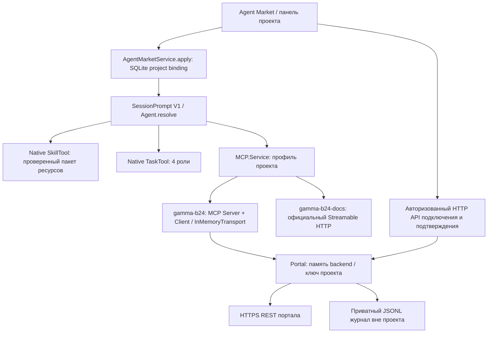

# Битрикс24 Разработчик — реализация в Gamma

Дата проверки: 10 октября 2026. Статус: **готов к испытаниям как локальный / single-owner MVP**, не production-ready multi-tenant SaaS. Реальный клиентский портал не подключался и не изменялся. Проверки REST выполнены на явно обозначенном mock API; официальный документационный MCP проверен по сети.

## 1. Что реализовано

- Карточка **«Битрикс24 Разработчик»**, ID `bitrix24-developer`, существующий дизайн Agent Market. В текущей схеме фильтр категории — «Разработка»; бизнес и интеграции отражены в назначении и задачах.
- Нативный профиль OpenCode V1, 6 пакетных skills с ресурсами, 4 запускаемых TaskTool subagents.
- Бесплатный локальный MCP действий: 4 инструмента, реальные HTTP REST-запросы через allowlist из 116 методов. Собственного agent runner нет.
- Отдельный официальный MCP документации: 5 инструментов. При успешном подключении обоих серверов всего **9 MCP tools**, помимо штатных read/edit/bash/skill/task и других инструментов OpenCode.
- Защищённая форма входящего вебхука, проверка соединения и прав, планы изменений с явным подтверждением человеком, повторное чтение для проверки, журнал фактически выполненных вызовов.
- Режим без портала: работа с исходниками, приложениями, интерфейсами, обработчиками и тестами; документация доступна независимо от портала.

В каталоге теперь 17 видимых карточек: 14 специалистов и 3 команды. Ещё 8 скрытых профилей — четыре роли 1С и четыре роли Битрикс24. Предыдущие 16 видимых профилей не удалены.

## 2. Архитектура и фактический runtime



Локальный MCP действительно выполняет MCP handshake, `tools/list`, `tools/call`, использует уже установленный `@modelcontextprotocol/sdk`. Он размещён **в процессе Gamma**, соединён через SDK `InMemoryTransport`, не является отдельным stdio-демоном. Это позволяет не передавать секреты в argv, environment дочернего процесса, stdin, локальные конфиги или localhost capability URL. Второй цикл работы модели не создавался.

Основные точки реализации:

| Файл / функция | Назначение |
|---|---|
| `gamma-agent-market/catalog.json`, `profiles/bitrix24-*.json`, `files.json` | Карточка, основной prompt, роли, permissions, контрольные суммы |
| `gamma-agent-market/bundles/bitrix24-development/manifest.json` | 6 skills, 31 файл с SHA-256, источники и лицензии |
| `packages/core/src/agent-market.ts`: `apply`, `withIdle`, `withRun` | Существующая атомарная привязка к проекту, версии, исключение смены занятого профиля |
| `packages/core/src/agent-market/catalog.ts`: `config`, `bundle` | Проверка профиля и ресурсов, отсутствие копирования секретов в проект |
| `packages/opencode/src/agent/agent.ts`: `marketAgent`, `resolve` | Основной агент и доступные дочерние роли; пересечение project permissions |
| `packages/opencode/src/session/prompt.ts`, `session/tools.ts` | Реальный V1 provider/tool loop; native permission check перед MCP-вызовом |
| `packages/opencode/src/tool/task.ts` | Настоящие дочерние сессии OpenCode |
| `packages/opencode/src/bitrix24/mcp.ts`: `connect`, `definitions` | Локальный MCP-протокол и четыре инструмента |
| `packages/opencode/src/bitrix24/portal.ts`: `Portal` | Vault, scopes, REST, лимиты, планы, аудит и редактирование секретов в ответах |
| `packages/opencode/src/mcp/index.ts`: `current` / `MCP.profileCurrent` | Подключение только для активного профиля, проверка инструментов, закрытие при замене |
| `packages/opencode/src/server/routes/instance/httpapi/bitrix24.ts` | Авторизованные endpoints подключения, статуса, перепроверки и подтверждения |
| `packages/app/src/components/bitrix24-connection.tsx` | Секретное поле формы, состояние подключения, просмотр и подтверждение плана |
| `packages/app/src/pages/agent-market.tsx`, `components/project-agent.tsx` | Карточка и открытие панели из выбранного проекта |

Минимальное расширение market permissions: TaskTool использует разрешение профиля **только для перечисленных members**. Битрикс24 разрешает самостоятельную делегацию своим четырём ролям; чужие роли и generic `general` остаются запрещены. Ограничения проекта по-прежнему пересекаются с разрешениями агента. Старые профили сохраняют `ask`.

Русские термины формы сверены с официальной поддержкой Bitrix24 и [русским интерфейсным корпусом Mozilla](https://github.com/mozilla-l10n/firefox-l10n/blob/main/ru/browser/browser/preferences/permissions.ftl); исходные продуктовые названия сохранены.

Интеграция и тесты относятся к **V1**. V2 session runner не изменялся; V2-совместимость не заявляется. Клиентский генератор и legacy SDK generator запущены; generated-файлы вручную не редактировались.

## 3. GitHub-источники, версии и лицензии

Репозитории изучены в `/tmp/gamma-bitrix-sources-rm7YBn`; сторонние установщики не запускались. В runtime Gamma новые npm-зависимости не добавлены.

| Источник | Зафиксированная версия / commit | Лицензия | Что использовано |
|---|---|---|---|
| [kostikpenzin/mcp_b24](https://github.com/kostikpenzin/mcp_b24) | 0.4.0; `74e9062ef04c53b6be336b778a73c5236996e015` | MIT, Penzin Konstantin, 2026 | Token bucket и выбранные статические `restMethod` mappings; адаптированы под безопасный Gamma gateway |
| [bitrix24/templates-mcp](https://github.com/bitrix24/templates-mcp) | 0.3.0; `1f825befd6bfcb620324bd87858977062fabf9ec` | MIT, Bitrix24, 2026 | Изучен как альтернатива; Nuxt/приложение не копировались и второй сервер не установлен |
| [vrtalex/bitrix24-skill](https://github.com/vrtalex/bitrix24-skill) | metadata 2.0.0; `73e781d48d2023f75f6e20afb5220d19bbd53e1a` | Unlicense | 8 отобранных reference-файлов; инструкции адаптированы под OpenCode и закрытый credential vault |
| [bitrix24/b24ui](https://github.com/bitrix24/b24ui) | 2.14.0; `473f4933b8bb3c17f21a0c93f5d1d96a04379e13` | MIT, Bitrix24, 2024 | Только skill `b24-ui-nuxt` и его 15 reference-файлов; Vue/Nuxt библиотека не установлена в Gamma |
| [Официальная документация MCP](https://github.com/bitrix24/b24restdocs/blob/main/ai-tools/mcp.md) | docs commit `831c06d04493691f3b5beaa8bfc1c9489490165b` | Документация изучена; её репозиторий в поставку не перенесён | Адрес сервера, Streamable HTTP, назначение инструментов |

Атрибуция сохранена в `src/bitrix24/vendor/LICENSE-mcp-b24`, `vendor/README.md`, `bundles/bitrix24-development/LICENSE-*` и manifest. `methods.json` хранит исходный filename для каждого метода.

### Почему адаптация mcp_b24, а не запуск всего CLI

Изучены его config, API client, token bucket, tool framework и выбранные tools. Upstream предоставляет webhook и OAuth, около 43 MCP-инструментов с многочисленными действиями, generic REST/batch, refresh токенов. Он не является готовым tenant-aware credential vault Gamma. В частности, ошибки разбора webhook могут включать исходный URL; `confirm: true` в tool arguments может выставить сама модель. Этого недостаточно для подтверждения человеком.

Поэтому использован ограниченный набор MIT-компонентов, а transport/vault/approval layer написаны для Gamma. Не заявляется полное покрытие upstream tools, OAuth или всех методов Bitrix24. `templates-mcp` требует Node >=22 и Nuxt; upstream mcp_b24 — Node >=18. Эти отдельные приложения в Gamma не запускаются. B24 UI требуется только в создаваемом клиентском приложении; его текущие engines — Node `^20.19.0 || >=22.12.0`.

Бесплатность локального MCP не означает бесплатность REST на любом тарифе портала. Например, для облачной зоны ru официальная поддержка указывает требование подписки для обычных локальных вебхуков; для входящих вебхуков коробочной версии это требование отличается. Gamma не покупает подписки и не обходит ограничения; без действующего доступа остаются разработка кода и документация. [Условия Bitrix24](https://helpdesk.bitrix24.ru/open/24577700/)

## 4. Skills и ресурсы

Namespace: `bitrix24-development:<имя>`. Пакет находится в `gamma-agent-market/bundles/bitrix24-development/skills`.

| Skill | Практическое содержание |
|---|---|
| `bitrix24-crm` | Лиды, сделки, контакты, компании, стадии, поля, смарт-процессы; исследование структуры, точные изменения, readback; catalog/chains core |
| `bitrix24-automation` | Различия роботов, процессов и обработчиков; события, idempotency, очередь, dedup, проверка auth mode и возможностей webhook |
| `bitrix24-backend` | REST, приложения, OAuth-проектирование, обработчики, интеграции с 1С/почтой, облако/коробка; platform references |
| `bitrix24-operations` | Scopes, pagination, rate limits, backoff, ошибки доступа, безопасные логи и диагностические сценарии |
| `bitrix24-review` | Проверка diff, secret leakage, REST-методов, побочных эффектов, идемпотентности, тестовых доказательств и полноты результата |
| `b24-ui-nuxt` | Официальные UI-рекомендации, компоненты, формы, dashboard, таблицы, overlays, навигация и другие выбранные рецепты |

SkillTool возвращает настоящий base directory. References читаются нативным ReadTool; пакет доступен только активному профилю и защищён от редактирования штатным механизмом bundle permissions. Проверены контрольные суммы и разрешение относительных Markdown-ссылок — отсутствующих локальных ссылок не обнаружено.

Upstream `bitrix24_client.py` и offline worker не перенесены: они образовали бы обход контролируемого подключения. Раздел о «включённых scripts» в выбранном reference адаптирован. API-действия выполняются MCP-инструментами, а код приложений — штатными инструментами OpenCode. OAuth, queues и deployment в справочных материалах являются требованиями к разрабатываемому приложению, не уже работающими службами Gamma.

## 5. MCP tools и покрытие операций

### Локальный `gamma-b24`

| Имя в OpenCode | Реальное действие |
|---|---|
| `gamma-b24_connection_status` | Статус текущего проекта, разрешённые методы, планы; без webhook или токенов |
| `gamma-b24_rest_read` | Проверенный метод чтения, параметры, 1–10 страниц; результаты помечены как недоверенные данные |
| `gamma-b24_prepare_plan` | Фиксирует 1–20 точных операций записи и idempotency key; не выполняет запись |
| `gamma-b24_execute_plan` | Однократное выполнение плана, подтверждённого в UI; остановка при первом сбое, результаты отдельных операций |

Allowlist: `packages/opencode/src/bitrix24/vendor/methods.json` — 116 методов: CRM 82 (35 чтения / 47 записи), задачи 9 (3/6), пользователи 12 (6/6), бизнес-процессы 8 (3/5), события 5 (3/2). Это **116 потенциальных REST methods, а не 116 MCP tools**.

Примеры: `crm.item.*`, `crm.type.*`, `crm.category.*`, `crm.deal.*`, `crm.contact.*`, `crm.company.*`, пользовательские поля, `tasks.task.get/add/update/delete`, `user.*`, `bizproc.workflow.*`, `event.get/bind/unbind`. Полный точный список — JSON allowlist. Доступ на конкретном портале определяется пересечением:

`allowlist ∩ выбранные в Gamma scopes ∩ scope портала ∩ methods портала ∩ разрешения пользователя API`.

Последняя граница проверяется самим Bitrix24 на каждом запросе. Ошибка доступа не преобразуется в успешное выполнение. Для новой разработки следует сверяться с актуальной документацией: документационный MCP уже помечает ряд legacy `crm.deal.*` методов как устаревшие в пользу `crm.item.*`; legacy оставлены для совместимости и тестовой задачи.

Отсутствуют generic `bx24_call`, arbitrary URL fetch и REST batch. REST 3.0, placement и произвольные методы вне allowlist через этот gateway не выполняются. Агент может разрабатывать соответствующий код приложения, но не должен заявлять его внедрение. Event binding и ряд операций приложений могут требовать application OAuth context и не работать с входящим вебхуком, даже если имя присутствует в документации.

### Официальный `gamma-b24-docs`

Адрес: `https://mcp-dev.bitrix24.com/mcp`, Streamable HTTP, без OAuth/секретов клиента.

- `gamma-b24-docs_bitrix-search`
- `gamma-b24-docs_bitrix-method-details`
- `gamma-b24-docs_bitrix-event-details`
- `gamma-b24-docs_bitrix-article-details`
- `gamma-b24-docs_bitrix-app-development-doc-details`

При подключении проверяется наличие всех пяти инструментов; изменение списка также фильтруется. Guard запрещает передачу сохранённого webhook/секрета и очевидных credential-параметров. Не следует передавать туда персональные данные или CRM-выгрузки: технический фильтр не является полноценным DLP.

Статус connected выставляется после MCP handshake и tools/list. Подключение к документации не означает подключение к порталу. Без сети доступны локальные skills и работа с кодом; документационный MCP честно показывает unavailable/disabled.

## 6. Subagents

| ID профиля / native имя | Назначение | Ограничения |
|---|---|---|
| `bitrix24-analyst` / `gamma-bitrix24-analyst` | Требования, CRM, доступы | Native edit deny; разрешено чтение доступного портала |
| `bitrix24-backend-developer` / `gamma-bitrix24-backend-developer` | REST, интеграции, handlers, OAuth-код | Может менять исходники и читать доступный портал |
| `bitrix24-app-developer` / `gamma-bitrix24-app-developer` | UI, приложения, B24 UI | `rest_read` deny |
| `bitrix24-reviewer` / `gamma-bitrix24-reviewer` | Code/security review | Native edit и `rest_read` deny |

У всех дочерних ролей `prepare_plan` и `execute_plan` deny; прямого доступа к credentials нет. Статус подключения доступен без секретов. Записи выполняет только ведущий после UI-подтверждения. Bash по-прежнему требует разрешения; это не ОС-песочница и не абсолютная read-only гарантия для процесса пользователя.

Все четыре роли **фактически запускались** как дочерние V1-сессии через TaskTool; это не только перечисление в prompt. В тесте model provider детерминированный, с настоящим OpenCode loop и TaskTool. Автономное качество решений коммерческой LLM этим не измерялось.

## 7. Как клиент подключает портал

1. Выбрать агента в «Готовых агентах» → «Использовать» → новый или существующий проект.
2. В проекте нажать «Битрикс24 Разработчик» и открыть «Подключение Битрикс24».
3. В Битрикс24 создать входящий вебхук с минимальными правами для задачи. Путь интерфейса и ограничения описаны в [официальной инструкции по вебхукам](https://github.com/bitrix24/b24restdocs/blob/main/local-integrations/local-webhooks.md). Если создание недоступно — обратиться к администратору портала.
4. Вставить секретный базовый URL **только в password-поле формы**, выбрать разрешённые разделы и нажать «Подключить и проверить доступ».
5. Gamma проверяет `scope`, `methods`, `user.current`; показывает безопасный адрес origin и доступные scopes. При ошибке выдаётся код/локализованное объяснение без исходного URL.
Первичное подключение разрешено и во время ожидания агентом ответа пользователя; market lease препятствует одновременной смене профиля. Замена уже подключённого портала требует завершения текущей задачи.

6. Агент исследует данные чтением. Перед изменениями подготавливает один конкретный план. В панели «Обновить статус и планы изменений» клиент видит описание, операции и точные параметры; подтверждает или отклоняет план.
7. После подтверждения попросить агента продолжить. Ведущий вызывает execute и затем readback; при частичном сбое сообщает выполненные/невыполненные шаги.

Ни в чат, ни в `.env` проекта секрет передавать не надо. Поле очищается при submit. Авторизация backend обязательна; форма разрешает HTTPS или loopback. Привязка агента сохраняется в SQLite, но webhook и планы — только в памяти на срок до 8 часов; таймер удаляет запись vault даже без последующих обращений. После перезапуска backend нужно подключиться заново. Ключ подтверждения находится только в памяти текущего браузера; после перезагрузки страницы для подтверждения требуется переподключение. Планы действуют 10 минут, максимум 100 на подключение.

HTTP endpoints под общей Authorization middleware:

- `GET /product/projects/:project/bitrix24`
- `POST .../connect`, `POST .../disconnect`, `POST .../check`
- `POST .../plans/:plan` — только подтвердить/отклонить, не выполнить.

Форма и model tools используют разные возможности. Модель не получает ключ браузерного подтверждения и не может заменить его `confirm:true`. HTTP API исполнения плана отсутствует; выполнение идёт через native MCP с проверкой активного профиля.

## 8. Настройки окружения

| Настройка | Значение |
|---|---|
| `OPENCODE_SERVER_PASSWORD` | Обязательная аутентификация Gamma для connect/approve/disconnect; задаётся администратором вне проекта и Git |
| `OPENCODE_SERVER_USERNAME` | Существующая настройка имени пользователя сервера, если используется |
| `GAMMA_BITRIX24_PORTAL_ORIGINS` | Необязательный список точных HTTPS origins через запятую для коробочных / нестандартных доменов, например `https://crm.example.org`; **без пути вебхука и секрета** |
| `GAMMA_BITRIX24_DOCS_DISABLED=1` | Отключить внешний docs MCP для offline/air-gapped режима; локальный MCP и skills остаются |
| `GAMMA_BITRIX24_LIVE_DOCS=1` | Только opt-in сетевой тест официального docs MCP |

По умолчанию разрешены перечисленные в `Portal.connect` стандартные cloud-домены Bitrix24. Неизвестный cloud-домен также требует явного origin в настройке. Частные IP запрещены, кроме origins, явно разрешённых администратором для коробочной версии. DNS проверяется, соединение использует проверенный адрес; redirect не следуется. Локальный HTTP mockOrigin существует только как аргумент конструктора в тестах, не как публичный endpoint/production env-флаг.

В этой среде Bun не поддерживал унаследованный SOCKS proxy; сетевой тест запускался с удалёнными proxy env-переменными только для процесса проверки. При подобной ошибке следует настроить поддерживаемый HTTP proxy или прямой доступ администратора, а не считать docs MCP подключённым.

## 9. Безопасность и границы гарантии

Проверено кодом и тестами:

- Привязка к канонической директории, проверка `ProductProjects.identifier/withProject`, активного профиля и версии; чужой project не получает connection или plan другого проекта через tools.
- Vault не имеет credential getter, не сериализуется, не выдаёт секрет в system prompt, child process env, конфиг проекта или tool response.
- Для плана проверяются конкретный метод, read/write классификация, параметры, scope и список доступных методов. Модель не может выполнить write через `rest_read`.
- Все записи, включая удаления, уведомляющие действия и запуск процессов, требуют подтверждения конкретного плана человеком. Решение одноразовое, concurrent approval не может изменить уже принятое решение; execute резервирует running до первого await.
- Exact idempotency key возвращает тот же план; конфликтующие данные отклоняются. Completed/failed plan не исполняется повторно. После рестарта durable idempotency не гарантируется — необходимо сверяться с журналом и порталом.
- Ограничены размер параметров (64 KB), ответ (2 MB), страницы, количество операций и планов. Token bucket ограничивает вызовы одного подключения примерно двумя в секунду.
- Retry/backoff только для чтения при 429 / QUERY_LIMIT_EXCEEDED / server errors; не более двух повторов. Записи автоматически не повторяются. Ошибка сети при write считается неопределённым результатом.
- Отмена останавливает следующие операции плана; уже отправленный запрос нельзя гарантированно отменить на стороне Bitrix24. Выполненные записи не откатываются.
- Из ответов удаляются credential-поля и известный секрет/URL. В журнал не записываются request params, бизнес-содержимое или webhook.
- Audit: `Global.Path.data/bitrix24-audit/<sha256-directory>.jsonl`, каталог 0700, файл 0600. Содержит timestamp, method, outcome, plan ID: connected/disconnected, read, approved/rejected, started, succeeded, failed_or_unknown. Конкретные параметры плана сопоставляются с историей сессии; журнал не является полной копией CRM-изменений.
- При смене профиля локальный и документационный MCP удаляются при следующем runtime refresh; старый tool handle дополнительно проверяет selection. Vault для предыдущего профиля очищается при этом refresh. API подключения немедленно проверяет текущую привязку.

**Ограничение tenant boundaries:** Gamma использует общий backend password и доверенную локальную файловую систему, а не отдельные tenant/user identities. Владелец backend, его администратор, процесс с правами того же ОС-пользователя или XSS в доверенном UI находятся вне этой модели изоляции. Общий backend нельзя выдавать независимым недоверенным клиентам как готовый SaaS. Профильные permissions не заменяют контейнеризацию, tenant authorization и secret manager.

Инструкции в CRM-полях считаются недоверенными данными и помечаются соответствующим образом; абсолютной защиты модели от prompt injection один prompt не гарантирует. Технические ограничения на секреты и записи остаются на стороне gateway.

## 10. OAuth: отделённая будущая архитектура

Работающий OAuth onboarding/token lifecycle **не реализован** и в форме явно обозначен как отсутствующий. Upstream OAuth не включён без tenant-aware storage. Поддерживается разработка OAuth-кода клиентского приложения через skill, но не подключение произвольного SaaS-клиента к Gamma.

Для следующего этапа нужны:

1. Аутентифицированная identity клиента и server-side binding `tenant + project + Bitrix member_id + approved portal origin`.
2. Отдельный OAuth installation/callback endpoint с одноразовым state, проверкой origin/member_id и защитой от повторной установки/подмены клиента.
3. Secret manager / шифрование at rest, ротация ключей, строго отдельное хранение access/refresh/client secret; токены не попадают в project Config, prompt или generic MCP environment.
4. Single-flight refresh, обработка revoked/expired/uninstalled, безопасный disconnect и удаление токенов, аудит без токенов.
5. Тип подключения `webhook | oauth` на границе transport credential provider. Существующие `rest_read`/plan tools и проверки операций сохраняются; OAuth не даёт обхода UI-подтверждения.
6. Проверки двух реальных клиентов, callback replay, cross-tenant API, refresh race, egress и уничтожения credentials после revoke.

Нужны также durable approved plans и результаты, crash recovery без повторных записей, централизованный лимитер по порталу/tenant, ротация и срок хранения audit. Текущий лимитер — per-connection, не общий для двух проектов одного портала.

## 11. Проверки и доказательства

### Автоматические тесты

- `packages/core/test/agent-market.test.ts`: 3 pass — все 25 конфигураций, привязки, целостность и отказ при tampering.
- В `packages/opencode`, целевой прогон: **13 pass, 2 skip, 0 fail**. Файлы: `test/bitrix24/portal.test.ts`, `test/server/bitrix24.test.ts`, `test/server/agent-market.test.ts`, `test/session/agent-market.test.ts`, `test/agent/market-permissions.test.ts`, `test/mcp/1c-agent.test.ts`, `test/mcp/1c-sources.test.ts`.
- Два skip относятся к опциональным проверкам 1С: настоящий BSL JAR и Python source tools не были настроены для этого прогона. Проверены изоляция 1С skills/roles и честная диагностика отсутствия Java/JAR; полный 1С runtime заново не заявляется проверенным.
- `test/bitrix24/docs.test.ts`: отдельный сетевой opt-in, **1 pass, 5 assertions**. Через реальный native MCP.Service получены 9 tools, выполнен `bitrix-method-details(crm.item.add)`, проверены secret guard и удаление tools при смене профиля.
- `bun typecheck` в opencode, app, core и schema — пройден. Проверки core/catalog также пройдены. Генераторы client и legacy SDK выполнены.

Сквозной server test поднимает реальные Node HTTP endpoints Gamma, SQLite binding, V1 SessionPrompt, native SkillTool + ReadTool для ресурса, MCP SDK client/server и mock Bitrix REST. Provider модели детерминированный. Через UI HTTP API подключается проект A; проект B остаётся отключён. Ведущий создаёт план, неподходящие approvals отклоняются, правильный approval разрешает реальную запись на mock. Затем выполняются `crm.deal.get` и `tasks.task.get`, проверяются фактические данные, transcript и отсутствие секретов. Проверены также отключение и смена профиля.

Отдельные protocol/transport tests проверяют handshake, missing credentials, scopes, read/write boundary, pagination, 429 retry, auth expiry, failed write без retry, idempotency, project isolation, запрет небезопасного URL, redaction в ответах/журнале и отмену плана.

Команды воспроизведения (из соответствующих package directories):

```sh
# packages/core
bun test test/agent-market.test.ts

# packages/opencode, без зависимости от внешнего документационного сервера
GAMMA_BITRIX24_DOCS_DISABLED=1 bun test \
  test/bitrix24/portal.test.ts test/server/bitrix24.test.ts \
  test/server/agent-market.test.ts test/session/agent-market.test.ts \
  test/agent/market-permissions.test.ts test/mcp/1c-agent.test.ts test/mcp/1c-sources.test.ts

# Отдельно, при доступе к официальному сервису и выключенном DOCS_DISABLED
GAMMA_BITRIX24_LIVE_DOCS=1 bun test test/bitrix24/docs.test.ts
bun typecheck

# packages/app
bun typecheck
```

### Реальные браузерные / сетевые проверки

В отдельном Gamma backend на 15096 и Vite на 15544, с изолированным XDG и тестовым workspace, через agent-browser:

- Отображены 14 карточек специалистов, включая 1С и Битрикс24; в деталях видны skills, tools, роли и ограничения.
- Через «Использовать» создан отдельный тестовый проект и настоящая сессия, в проекте выбран нужный профиль.
- Панель показала локальный MCP connected, официальный docs MCP connected и отдельно **portal disconnected**.
- На ширине 390 px карточка/диалог не создают горизонтальный overflow; password-поле сохраняет тип password. Для кнопок добавлен fallback цвета: переменная market-accent недоступна в portal-диалоге вне market container.
- Без server password попытка подключения отклоняется до обращения к порталу. Использовалась заведомо фиктивная строка; поле очищено, в localStorage её нет.

Браузерная проверка UI и сквозной HTTP→session→MCP→mock тест выполнены отдельно. **Единого browser→LLM→реальный Bitrix24 e2e с порталом клиента не было.** Это не скрывается за mock-результатами.

### Не проверено на реальном портале

Настоящая cloud/on-premise авторизация, тарифные особенности, создание/изменение CRM и задач, пользовательские поля, смарт-процессы, события, business workflows, app placement, боевой 1С/почтовый обмен и OAuth. Для этих операций нет предоставленного стенда/credentials. Реальные клиентские данные не читались, платные посредники и API-подписки не использовались.

## 12. Что осталось до production

- Проверка на выделенном cloud и коробочном стенде с минимальными scopes; отдельно разрешённые записи и уведомления.
- Tenant identity/authorization, isolated execution, secret manager и полноценный OAuth lifecycle.
- Durable approval/idempotency/audit с восстановлением после аварий без автоматического повторения записи.
- Общий лимитер по порталу, проверка role-specific scopes и более полная проверка параметров каждого REST-метода.
- Развёртывание обработчиков/очередей как отдельная явная возможность; не объявлять сгенерированный исходник работающей автоматизацией.
- Реальная browser→model→portal e2e и evaluation качества самостоятельного решения бизнес-задач.

Это рабочая интеграция для испытаний с контролируемым доступом: профиль запускается, skills читаются, subagents выполняются, MCP вызывает REST, неподтверждённые изменения блокируются. Гарантии полноценного SaaS и поддержки всего интерфейса Bitrix24 не заявляются.
