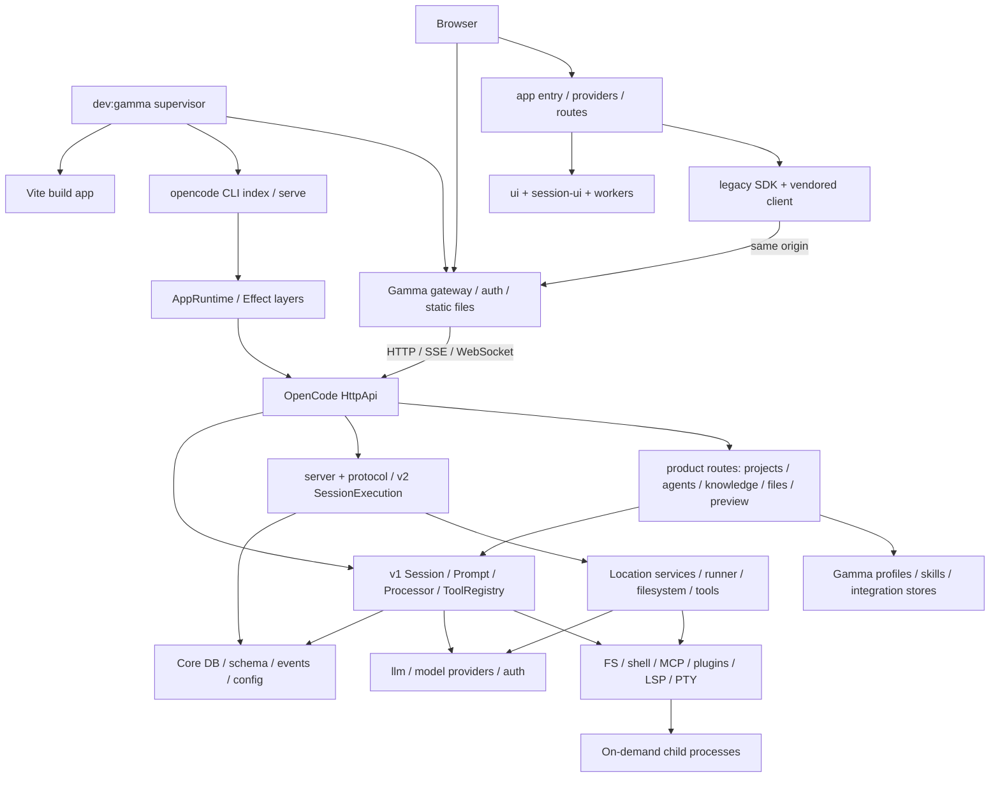

# Gamma: аудит наследия OpenCode, зависимостей и runtime

Дата: **12 октября 2026**. Режим: **только аудит**. Приложение, агенты, данные, конфигурация рабочего запуска и production не изменялись. Новые зависимости не устанавливались. Изменения этой работы — отчёт и диагностические артефакты в `docs/audits/evidence/gamma-legacy-2026-10-12/`.

## 1. Вывод

**Gamma сильно зависит от OpenCode как от работающего движка, а не только как от исторической основы UI.** Сессии, история, исполнение инструментов, разрешения, модели, файловая система, события и терминал используют его архитектуру. Удаление `packages/opencode`, `core`, legacy SDK или v1 session pipeline сейчас сломает продукт.

При этом избыточность есть, и она неоднородна:

1. **9 безопасных единиц очистки:** восемь недостижимых UI-файлов и одна неиспользуемая локальная функция. Они уже исключены из emitted JS; это уменьшение сложности сопровождения, а не доказанное ускорение.
2. **13 условных единиц очистки:** отдельные upstream-продукты, альтернативные приложения, старый визуальный интерфейс, необязательные серверные функции и группы лишних деклараций зависимостей. Удаление требует согласованного сокращения поддерживаемых сценариев либо проверки install/build/exports.
3. **3 неопределённые группы:** стили/assets, провайдеры и совместимость с сохранёнными данными. Отсутствия вызовов в одной сессии недостаточно.
4. **10 направлений оптимизации:** initial JS, прогрев истории, CLI/preload при headless-запуске, повторные справочные запросы и другие описанные ниже расходы. Это отдельный список; он не прибавляется к количеству кандидатов на удаление.

**Тяжёлых библиотек, доказанно безопасных для полного удаления из Gamma, не найдено.** Three.js, 3D force graph, PDF, DOCX, терминал и подсветка выполняют реальные функции; многие уже загружаются отложенно. Наибольший подтверждённый резерв для холодного frontend — границы загрузки страниц и прогрева, для backend — ширина startup-графа CLI и preload. Размер выигрыша после их изменения ещё не измерен.

## 2. Методика, охват и границы доказательств

Исследован текущий рабочий каталог, который **уже содержал многочисленные изменения и новые файлы** до аудита. Это не аудит чистого upstream commit. HEAD, версии, SHA-256 ключевых исходников и предыдущего отчёта: [manifest.json](evidence/gamma-legacy-2026-10-12/manifest.json).

Выполнено:

- Инвентаризация **7 463 файлов**, AST-разбор **3 547 TS/TSX/JS-файлов**, **20 985** деклараций import/export/литеральных dynamic import/require. Это количества на момент сканирования, до добавления собственных evidence-файлов.
- Найдено **40 значимых package manifests**: 36 под `packages/`, корень, `deploy`, `github`, `sdks/vscode`. Fixture manifests и vendored-исходники исключены из перечня самостоятельных приложений.
- Построен граф деклараций workspace-зависимостей: **72 ребра dependencies/devDependencies**. Он не выдаётся за граф реально запущенных модулей.
- Проверены публичные exports, app/desktop entrypoints, CLI, генераторы, динамические импорты, worker URL, Storybook globs, регистры providers/plugins и production installer.
- Выполнены две Vite production-сборки в **новые каталоги `/tmp`**: конфигурация `dev:gamma` и `OPENCODE_CHANNEL=prod`, как у installer. Существующий `packages/app/dist` не пересобирался.
- В отдельных процессах: три старта API с новой SQLite БД на каждый старт; gateway; браузер с реальным пустым backend; UI-сценарии с v1/v2 fixture и незакрывающимся синтетическим SSE; отдельная диагностическая выгрузка module cache Bun.
- Получен фактический OpenAPI из изолированного backend: **162 пути, 188 операций**. Это OpenAPI-поверхность, не количество используемых Gamma функций; raw router fallback может не входить в спецификацию.

Ограничения, важные для интерпретации:

- Static scanner не является полноценным доказательством отсутствия всех путей в monorepo. Для SAFE REMOVE его результат дополнен проверкой конкретных символов, exports, конфигураций и production bundle. Неопределённые динамические загрузки не объявлены dead code.
- Изолированному API заданы собственные HOME/XDG/DB/knowledge/workspaces. Отключены models fetch, autoupdate, внешние plugins и project config; `OPENCODE_PURE=1` также меняет доступные LSP/format сценарии. **Эти метрики не эквивалентны обычному запуску со всеми интеграциями.** Env стенда описан в [runtime.json](evidence/gamma-legacy-2026-10-12/runtime.json).
- API стартовал из штатного `packages/opencode`, как `dev:gamma`. При UI bootstrap сервер поэтому обнаруживает этот directory как instance; конфигурация и SQLite остаются изолированными. Пользовательские prompts, инструменты и LLM не запускались.
- Реальный backend проверен на пустой базе. Chat/Projects с историей проверены production frontend + fixtures. Эти результаты не доказывают производительность реального большого проекта или модели.
- `agent-browser` отсутствует в PATH. Для измерений использован уже установленный Playwright/Chromium; ничего не скачивалось.
- Длительный soak, реальные провайдеры, desktop/WSL, installer на VPS, upgrade существующей БД, реальные PTY и многопользовательский streaming в этом аудите не прогонялись.
- Тесты/типизация для изменённого runtime не требовались: runtime-код не менялся. Успех сборки не заменяет регрессионную матрицу будущей очистки.

Полный статический граф остаётся локально в `/tmp/gamma-legacy-audit/inventory.json`; воспроизводимый scanner, сокращённые графы и результаты включены в evidence. Время сборок и module `renderedLength` имеют отдельную семантику от размера финальных файлов, см. раздел 8.

## 3. Архитектура и реальные точки входа

### 3.1. `bun run gamma` и фактическая команда

В текущем [package.json](../../package.json) **нет script `gamma`**. Фактическая команда — **`bun run dev:gamma`**. Файл `script/dev-gamma.ts` не вызывает отдельный продуктовый движок Gamma: он оркестрирует frontend, OpenCode API и gateway.

Последовательность [script/dev-gamma.ts](../../script/dev-gamma.ts):

1. Выбрать data root, по умолчанию `~/.local/share/gamma-dev`; проверить наличие `auth/auth.json` и `auth/backend.env`.
2. Настроить пути БД, knowledge, workspaces, XDG и origin; убрать унаследованные SOCKS proxy URL из окружения дочерних процессов.
3. Дождаться `bun run build` в `packages/app` — **Vite production build при каждом запуске**, без dev HMR.
4. Запустить `bun --env-file=… run ./src/index.ts serve --hostname 127.0.0.1 --port 4108` из `packages/opencode`.
5. Опросить `/global/health` без credentials до ожидаемого `401` (до 60 секунд).
6. Запустить `bun … run deploy/web.ts` на 4456. Gateway отдельно проверяет, что backend действительно защищён и доступен с внутренними credentials.
7. Держать supervisor; при завершении ребёнка завершить оба.

Во время сборки дополнительно работают Bun/Vite и build workers. В установившемся локальном запуске логически остаются **supervisor + API + gateway**; `bun run` и shell могут добавлять wrapper PID. Это не означает три бизнес-сервера. В production supervisor не нужен: systemd владеет **двумя сервисами**. Nginx/Certbot добавляются в зависимости от способа HTTPS.

### 3.2. Production и установка

`install-gamma.sh` → `deploy/installer/gamma_installer.py`:

- `build_release()` делает новый release checkout, `bun install --frozen-lockfile` **для всего workspace**, затем собирает только `packages/app` с `OPENCODE_CHANNEL=prod`.
- `rendered()` формирует реальные unit-файлы с release path; шаблоны `deploy/gamma-*.service` не являются единственным источником production запуска.
- API по-прежнему работает из TypeScript entrypoint `packages/opencode/src/index.ts`, а не из минимального скомпилированного Gamma binary.
- Gateway отдаёт собственный `dist`, проверяет login/session и проксирует HTTP/SSE/WebSocket. Nginx обеспечивает публичный HTTPS/preview там, где включён.
- Установщик отключает upstream share и autoupdate (`OPENCODE_DISABLE_SHARE=1`, `OPENCODE_DISABLE_AUTOUPDATE=1`), но сохраняет собственные install/update/rollback и конфигурацию автоматических разрешений.

**Следствие:** неиспользуемые приложения в workspace могут увеличивать установку, dependency tree и release directory, даже если не запускаются. Это отдельный эффект от CPU/RAM Gamma. Удалять installer, release transactions, agent/skill markets или миграции БД ради уменьшения monorepo нельзя.

### 3.3. Карта monorepo

Полные names/scripts/exports: [package-inventory.json](evidence/gamma-legacy-2026-10-12/package-inventory.json). Декларации связей: [workspace-graph.json](evidence/gamma-legacy-2026-10-12/workspace-graph.json).

| Пакет / область | Назначение и entrypoint | Роль в Gamma |
|---|---|---|
| Корневой manifest, `script/` | `dev`, `dev:gamma`, `dev:web`, `dev:desktop`, console/stats/storybook; codegen/release/audit scripts | Сборка/оркестрация; большинство scripts не daemon |
| `deploy` | `web.ts`, `auth.ts`, `setup-auth.ts`, installer Python, service/nginx templates | **KEEP**, продуктовый gateway и deployment |
| `app` | `index.html` → `src/entry.tsx` → `app.tsx`; Vite build | **KEEP**, браузерный UI |
| `ui`, `session-ui` | Компоненты, стили, темы, Markdown/diff/worker/composer | **KEEP**, части реально входят в bundle; не все exports одновременно используются |
| `opencode` | `src/index.ts` → CLI `serve` → API; также TUI/run/acp/debug/github и прочие команды | **KEEP**, основной backend и v1 engine; альтернативные команды условны |
| `core` | Effect services, БД/миграции, v1 schemas, v2 runner, инструменты, plugins/config | **KEEP**, критическая инфраструктура |
| `schema`, `protocol`, `server` | Типы/schema, HttpApi и handlers v2 | **KEEP**, backend и клиентские контракты |
| `llm` | `src/index.ts`, route client/protocol adapters/streaming/tool definitions | **KEEP**, model execution; eager imports изучены отдельно |
| `sdk/js` | Legacy SDK, `script/build.ts` | **KEEP**, frontend/backend/plugin callers v1 и совместимость |
| `client` | Новый client, generator `script/build.ts` | Источник/generator **KEEP**; app и session-ui используют **vendored tgz**, а не только текущий workspace source |
| `plugin` | Контракты и API plugins v1/v2 | **KEEP**, runtime и сторонние расширения |
| `effect-drizzle-sqlite` | Database integration | **KEEP**, импортируется `core/database/database.ts` |
| `effect-sqlite-node` | Альтернативный SQL adapter | Условный кандидат: декларация core есть, runtime-import не найден; нынешний Node путь реализован в core |
| `tui` | Терминальный интерфейс и shared terminal helpers | Условный UI; **5 его модулей реально загружены headless CLI**. Нельзя удалить пакет целиком без перепривязки imports |
| `codemode` | Tool execution/sandbox infrastructure | Условное исполнение инструментов; не считать мусором по отсутствию на Home |
| `cli`, `sdk-next` | Альтернативный v2 CLI/service/daemon и композиция Client/Core/Server | Не запускаются `dev:gamma`; условные, миграционные/внешние consumers требуют проверки |
| `httpapi-codegen`, `script` | Генераторы и tooling | Нужны для поддержки контрактов/build; не runtime-daemon |
| `http-recorder` | Запись HTTP, fixtures/tests provider integration | Нужен тестам/tooling; отсутствие в serve не основание удалять |
| `desktop` | Electron main/preload/renderer; Electron Vite/builder | Отдельное приложение, не web Gamma; условное удаление только при отказе от desktop |
| `storybook` | Stories app/ui/session-ui, port 6006 | Development-only, не запущен Gamma; сохранить если нужен UI review |
| `slack` | `src/index.ts` | Отдельная интеграция; не запускается автоматически |
| `web`, `docs` | Upstream Astro site/docs, документация | Не frontend Gamma; conditional upstream publishing |
| `enterprise` | Отдельное приложение Teams/share/deployment | Не локальный Gamma gateway; отдельный deployment |
| `function` | Upstream functions/infra consumers | Не Gamma daemon, но проверить SST deployment callers |
| `console/app`, `console/core`, `console/function`, `console/mail`, `console/resource`, `console/support` | Console web, billing/auth/server functions, emails, support, resource types | Шесть upstream workspace manifests; не запускаются Gamma |
| `stats/app`, `stats/core`, `stats/server` | Analytics app/DB и `src/stat-sync.ts` | Три отдельных workspace; не запущенные фоновые analytics Gamma |
| `containers`, `infra`, `sst.config.ts` | Upstream packaging/deployment | Не вызываются `dev:gamma`; связаны с публикацией других продуктов |
| `github`, `sdks/vscode` | GitHub Action и VS Code extension | Отдельные manifests вне 36 packages; собственные build/publish workflows |
| `gamma-agent-market`, `gamma-skill-market` | Profiles, skills, bundles, assets, runtime requirements | **KEEP**, данные и инструменты готовых агентов, не независимые постоянно работающие сервисы |

Наличие package или workflow не означает его запуск. И наоборот: devDependency/внешний import может требоваться source-based production, поэтому удаление devDependencies «потому что production» небезопасно.

### 3.4. Runtime-граф Gamma

Это граф отношений runtime, не предлагаемое направление imports. Архитектурные границы Schema → Core/Protocol → Server и запрет runtime Client → Core/Server должны сохраняться. Imports frontend из `core/util/*` не означают включение всего backend в браузер.

## 4. Что Gamma действительно использует от OpenCode

### 4.1. V1 и V2 — обе ветки живы

- `packages/app/src/utils/server-protocol.ts` сначала проверяет `/global/health`; `{healthy:true}` выбирает **v1**, даже если `/api/*` также существует.
- На реальном изолированном backend наблюдались `/global/event`, `/global/config`, `/provider`, `/path`, `/session/status`, `/project` — это не теоретическая совместимость.
- Одновременно Home запрашивает `/api/session?limit=5000&order=desc` для индекса истории. Gateway пропускает обе группы путей.
- `packages/opencode/src/server/routes/instance/httpapi/server.ts` регистрирует root/instance handlers и новые `@opencode-ai/server/handlers`. В `agent-market.ts` продуктовые actions получают `Session.Service` v1; это прямой путь Gamma → legacy engine.
- V2 `SessionExecution`/runner имеют durable inbox, session ownership и Location services. Их смысл не заменяется v1 orchestration. Нельзя свести два pipeline к одному без отдельной миграции контрактов и истории.
- Legacy URL redirects, адаптеры событий, metadata и сохранённые tabs обеспечивают переход существующих данных. Отсутствие кнопки в текущем UI не доказывает, что старые ссылки не используются.

### 4.2. Поверхность маршрутов

Фактический `/doc` перечисляет 162 пути/188 операций, но **не включает дополнительные Gamma `/product/*` группы**, зарегистрированные отдельно в `createRoutes()`. Поэтому это не полный счёт всех HTTP handlers. Сочетание OpenAPI + source inventory необходимо.

| Группа | Регистрация / consumer | Статус |
|---|---|---|
| `/global/*`, `/session/*`, `/provider/*`, `/project/*`, `/path`, `/config`, `/agent`, `/command` | `opencode/.../httpapi/{api,server}.ts`; v1 SDK, protocol detection, UI bootstrap и coding-agent | KEEP, использование подтверждено |
| `/api/*` | `protocol/src/groups`, `server/src/handlers`, v2 handlers composition | KEEP; история Home и v2 clients, даже когда detector выбрал v1 |
| `/event`, `/global/event`, `/api/event`, `/pty/*` | event/pty handlers, ServerSDK, терминал | KEEP; один protocol-specific поток, не три обязательных потока на вкладку |
| `/permission`, `/question`, `/mcp`, `/lsp`, `/formatter`, `/file`, `/find`, `/vcs`, `/skill` | bootstrap/инструменты/плагины/scoped services | KEEP или условная пользовательская активация; отсутствие обращения на Home не доказывает ненужность |
| `/product/projects`, `/product/session/*` | `workspace-files.ts`, `site-preview.ts`; GammaShell, WorkspaceFiles, lifecycle | KEEP, включая preview/download/upload/discard-empty |
| `/product/agent-market/*`, `/product/projects/:project/{active-agent,agent-check,sessions}` | `agent-market.ts`; готовые агенты, выбор конфигурации | KEEP |
| `/product/knowledge/*`, `/product/skill-market/*`, product integrations | `knowledge.ts`, `skill-market.ts`, `bitrix24.ts`, `wildberries.ts` | KEEP; backend skills нужны даже после удаления недостижимого SkillMarketPage |
| `/tui/*` — **13 операций** | `groups/tui.ts`, `handlers/tui.ts`, control endpoints; внешнее управление TUI | Условная поверхность C11: зарегистрирована в API, TUI listener/runtime от этого не стартует. Gateway API-regex не включает `/tui`; browser Gamma её не использует |
| `/sync/*`, experimental/control-plane/workspace routes | Legacy синхронизация и альтернативные clients/adapters | Недостаточно данных для удаления: учитывать CLI, plugin/remote workspace, миграции; U03 |
| `/doc`, backend UI fallback | docRoute/uiRoute; standalone API tooling и `opencode web` | Документацию оставить для диагностики; UI fallback — C11. Это не Gamma gateway |

### 4.3. Критические части, которые нужно сохранить

| KEEP | Почему необходимо / что сломает удаление |
|---|---|
| `opencode/src/session/*`, `core/src/session/*`, database schemas/migrations/projectors | Сессии, история, admission/promote, retry/idempotency, interruption, queue/steer, resume, совместимость данных |
| `core/src/tool/*`, `opencode/src/tool/*`, permissions/questions/background jobs | Coding-agent, task/subagent, автоматическое выполнение, контроль запросов разрешений; «не видно на Home» ничего не доказывает |
| `llm`, provider/model/auth/integration registries | Streaming, model selection, dynamic SDK loading, credentials и разные LLM protocols |
| FS/search/watch/snapshot/worktree/PTY/LSP/MCP/plugins | Чтение/правка, shell, события файлов, откат, терминал и подключаемые инструменты |
| `EventV2`, bridges, SSE, WebSocketTracker, gateway proxy | Синхронизация UI, поток токенов, permissions/questions, PTY; повторное состояние после reconnect |
| Gamma product routes, knowledge store, agent/skill markets, Bitrix24/Wildberries/presentation | Реальные продуктовые функции и конфигурации агентов; фоновые таймеры интеграций чаще создаются после соединения/задачи |
| `three`, `3d-force-graph`, `knowledge-node-material`, `patches/three@0.186.1.patch` | Обязательный 3D-граф. Патч освобождения LUT уже проверен предыдущим аудитом |
| `mammoth`, `pdfjs-dist`, DOCX/PDF workers | Просмотр/обработка материалов базы знаний, а не upstream-остаток |
| `playwright` в opencode, browser dependencies installer | `presentation/browser.ts` делает **dynamic `import(source)`**. Scanner без учёта этого ошибочно назовёт dependency unused |
| `tree-sitter-bash`, `tree-sitter-powershell`, `web-tree-sitter` | `tool/shell.ts` импортирует WASM через выражение с `as string`; нужен анализ shell-команд |
| `deploy/*`, installer/update/rollback и auth | Требование установки/обновления/production. Это уже Gamma, не заменяемый OpenCode UI proxy |

## 5. Что реально запускается и монтируется

### 5.1. Backend startup

`src/index.ts` статически импортирует описания всех CLI-команд. `ServeCommand` лениво импортирует сервер, но до handler значительная часть дерева уже загружена. Затем `effectCmd` использует `AppRuntime`, даже при `instance:false`.

- `AppRuntime` явно перечисляет **48** nodes; HttpApi composition — **60**; Location group — **36**. Это размеры списков, **не 144 уникально инициализированных сервиса**.
- Общий `memoMap` и Layer compilation переиспользуют layers. Наличие двух списков не доказывает двойную инициализацию БД/MCP/events.
- `serve` не создаёт project instance заранее. Instance появляется по directory-scoped запросам, в том числе через bootstrap UI.
- `InstanceBootstrap.run`: config → plugin → LSP/share/format/VCS/snapshot/project. Создание service handle не равно запуску LSP/MCP subprocess. VCS имеет forked init; Snapshot — периодический housekeeping; LSP запускает подходящий сервер при соответствующей работе.
- Location service map строится по запросу Location, с **idle TTL 60 минут**. Это намеренный кэш ресурсов проекта, потенциально существенный для RAM при многих проектах; не доказанная утечка.
- ModelsDev при обычном запуске делает refresh сразу и затем раз в **60 минут**; cache freshness 5 минут, сетевой timeout 10 секунд. В стенде fetch отключён, поэтому стоимость сети здесь не измерена.
- ShareNext без `OPENCODE_DISABLE_SHARE` регистрирует **5 event listeners** при instance init. До наличия shared session отправка не производится. Installer выставляет disable flag; `dev:gamma` сам его не выставляет.
- mDNS по умолчанию false; auto heap snapshot timer включается только flag; TUI worker создаётся в handler TUI, а не в `serve`; LLM/tool loop без принятого prompt не запускается.

В отдельном preload-наблюдении спустя 5 секунд в Bun module cache было **3 168 записей**. Среди них: opencode 354, core 299, schema 65, llm 55, sdk 34, server 27, protocol 22, effect-drizzle-sqlite 17, tui 5, plugin 2. Также реально загружены OpenTUI preload/transform, Babel, OpenAI/Anthropic SDK, GitLab auth с Fastify и его транзитивными модулями. **Загруженный Fastify/ioredis не означает запущенный дополнительный HTTP/Redis сервер.**

Наблюдение получено через `require.cache`; это диагностический список cached modules, не полный tracing evaluation каждого ESM и не стоимость модуля в миллисекундах. Исходный код и список подтверждают кандидат на lazy-loading CLI/preload; они не доказывают конкретную экономию RSS. [loaded-module-summary.json](evidence/gamma-legacy-2026-10-12/loaded-module-summary.json).

### 5.2. Frontend providers и страницы

`entry.tsx` загружает начальную locale, затем `PlatformProvider → AppBaseProviders → GammaAuthGate → AppInterface`.

В base/provider tree живут Theme(lightOnly), Language, Query, WSL, Dialog, Onboarding, FileComponent; внутри authenticated app — Server/Global/Settings/Tabs/Permission/Notification, команды, layout/models и GammaShell. Global создаёт контекст на каждый сохранённый server, а не только на активную страницу.

| Экран | Что добавляется к общей оболочке | Автоматическая работа |
|---|---|---|
| Home | `NewHome → HomeOnboarding`; GammaShell уже содержит home/projects/sessions controllers | projects + session index; при истории — prefetch первых **двух** сессий и Markdown их text parts |
| Projects | Самостоятельного `/projects` route нет: это Home/dashboard и выбор проекта в GammaShell | Выбор/открытие использует существующий индекс; создание — явный action |
| Agents | `AgentMarketPage → AgentMarketCatalog` | GET `product/agent-market/agents`; карточки интеграций не означают автоматический запуск их задач |
| Knowledge | `KnowledgePage`, editor/viewer boundaries, graph по данным | IndexedDB → cached remote → GET knowledge; BroadcastChannel. Пустая база не создаёт WebGL renderer |
| Chat | Session lineage → directory providers, timeline, composer, WorkspaceFiles, TerminalProvider и conditional terminal panels | agents/providers/permissions/questions/MCP/references, сообщения; knowledge picker/catalog; files/preview |

Страницы Home/Agents/Knowledge/Session импортированы **статически** в `app.tsx`. Только NewSession явно lazy на уровне этого файла. Это означает загрузку кода до первого клика, **но не одновременный mount всех экранов**.

Old layout не просто удалён из settings: `oldInterfaceSunset = new Date(2026, 8, 14)`, после локальной даты 14.09.2026 `resolveNewLayoutDesigns()` возвращает true. Однако runtime date gate не является compile-time constant; `LegacyLayout` остаётся в entry, а `/:dir` compatibility subtree ещё регистрируется. Для удаления нужны сохранение redirects и проверка исторических tabs/desktop/test сценариев.

### 5.3. Подписки, таймеры и работа без действия пользователя

| Источник | Когда активен | Cleanup / вывод |
|---|---|---|
| `context/gamma-auth.tsx` | check при mount; каждые **30 секунд**, focus/pageshow/visibility | listeners и interval убираются; необходим контроль auth, можно объединять одновременные checks |
| `utils/server-health.ts`, Global | initial и каждые **10 секунд** на сохранённые servers; promise cache **750 мс** | interval cleanup есть. `disableHealthCheck` у ConnectionGate **не отключает Global polling** |
| `context/server-sdk.tsx` | одна выбранная SSE-ветка v1/v2 на server context; flush 16 мс, reconnect 250 мс | AbortController, timer/listener cleanup есть; две SDK переменные не означают два одновременно открытых SSE |
| `server-sync.tsx` | global event subscription, scoped child stores и query invalidation | несколько onCleanup; кэши и Solid stores дополняют друг друга, не доказанный случай дублирования всей истории |
| `home-sessions-controller.tsx:108` | prefetch двух верхних записей, независимо от реального клика | `prefetched` Set и finally(dispose); возможный startup trade-off, а не забытый daemon |
| `gamma-shell.tsx` | pagehide/смена session запускает discard-empty | продуктовая функция удаления пустых сессий; нельзя убрать как «лишний фоновый POST» |
| `knowledge.tsx` | BroadcastChannel + загрузка local/cache/remote | channel закрывается; не все async результаты защищены generation/disposed guard — уже отмечено предыдущим аудитом |
| `knowledge-graph.tsx` | после mount непустого графа: ResizeObserver, renderer/RAF, interval, events | cleanup и LUT patch существуют; предыдущий lifecycle-аудит не повторяется |
| `workspace-files.tsx` | preview refresh при смене session, focus и **10 секунд** в видимой вкладке; file poll **3 секунды**, только busy + open | cleanup/abort есть; preview poll при отсутствии сайта — кандидат на событийную/адаптивную схему |
| Markdown/DOCX/PDF workers | Markdown при прогреве/отрисовке; документы по открытию | нужны; нельзя считать worker файл dead по отсутствию import: он подключается через `new URL(..., import.meta.url)` |
| WSL provider | монтируется в base, но query `enabled: !!platform.wslServers` | В web platform API отсутствует: **нет реального WSL probing** |
| Sentry | `Sentry.init` только при DSN | captureException imports остаются; наличие библиотеки не доказывает отправку телеметрии без DSN |

Три QueryClient-области тоже не равны трём дубликатам: внешний base context, внутренний router context и `Global.createServerCtx().queryClient`, который используется `settings-server-picker.tsx`. Есть смысл проверить лишнюю вложенность, но объединять кэши без server scope/ownership опасно.

## 6. Реестр кандидатов на удаление

Единица подсчёта — **строка реестра**, а не каждое имя в группе. SAFE REMOVE относится к текущим внутренним entrypoints/exports репозитория; не к обещанию сторонним потребителям произвольных deep-import путей.

### 6.1. SAFE REMOVE — 9 единиц

Проверка для S01–S08: AST incoming edges, поиск точных export symbols и paths по исходникам/hidden files, app public exports, desktop, Storybook globs, динамические loaders, emitted chunks. Для S08 остаётся только неиспользуемый import в `app.tsx`, который нужно убрать вместе с файлом. Для S09 символ встречается только в объявлении.

Доказательства: [orphan-evidence.json](evidence/gamma-legacy-2026-10-12/orphan-evidence.json), [orphan-symbol-search.txt](evidence/gamma-legacy-2026-10-12/orphan-symbol-search.txt), [orphan-boundaries.txt](evidence/gamma-legacy-2026-10-12/orphan-boundaries.txt), [entry-modules.json](evidence/gamma-legacy-2026-10-12/entry-modules.json).

Все пути ниже относительно `packages/app/src/`.

| ID | Файл / символ | Назначение и чем заменён | Кто вызывает / косвенные зависимости | Эффект, риск, уверенность |
|---|---|---|---|---|
| S01 | `components/dialog-select-directory.tsx` | Старый directory picker; выбранные реальные места используют `dialog-select-directory-v2` | Нет callers/exports/динамической регистрации. Его domain helpers используются отдельно — **не удалять их** | −200 строк; JS/runtime выигрыш не подтверждён. Риск низкий, высокая уверенность |
| S02 | `pages/home/home-projects.tsx` | Прежняя view-обёртка HomeProjects | Нет callers. GammaShell использует controller и `HomeUtilityNav` непосредственно | −48 строк; controller/view сохранить. Низкий риск, высокая уверенность |
| S03 | `pages/home/home-sessions.tsx` | Прежняя view-обёртка HomeSessions | Нет callers. Sessions controller нужен GammaShell/prefetch/search | −47 строк; зависимости остаются. Низкий риск, высокая уверенность |
| S04 | `pages/session/review-tab.tsx` | Старый review tab | `SessionReviewTab` нигде не вызывается; module отсутствует в chunks | −167 строк. `SessionReview`, review domain и tests не удалять. Низкий риск, высокая уверенность |
| S05 | `pages/session/session-side-panel.tsx` | Прежняя боковая панель файлов/diff | Нет imports/callers; текущий `session.tsx` использует `WorkspaceFiles` и другие активные компоненты | −867 строк, самый большой безопасный UI-файл. Старые e2e selectors не являются import этого файла. Низкий риск, высокая уверенность |
| S06 | `pages/session/v2/review-panel-v2.tsx` | Неиспользуемая версия review UI | Нет callers/chunks. `review-panel-v2-state` имеет отдельные тесты — это другой модуль | −251 строк; state/shared helpers не включены в удаление. Низкий риск, высокая уверенность |
| S07 | `pages/skill-market.tsx` | Старый отдельный экран каталога навыков | Нет callers; `/skills` в router ведёт на `/knowledge` | −430 строк. **Не удалять** `skill-market.css`, backend skill routes/market: они используются Agents и агентами. Низкий риск удаления файла, высокая уверенность |
| S08 | `pages/product-placeholder.tsx` + unused import в `app.tsx` | Заглушка ещё не реализованных продуктовых страниц | Только import без JSX/call; tree-shaken | −13 строк файла + import. Низкий риск, высокая уверенность |
| S09 | `app.tsx::LayoutCompatibility` | Старая логика переключения server при несовместимом layout | Только локальное объявление, не export, не mount | Удаление мёртвой функции. Не удалять server protocol compatibility. Низкий риск, высокая уверенность |

Восемь файлов S01–S08 суммарно: **84 589 байт исходников, 2 023 строки**. Все восемь отсутствуют в emitted JS. Поэтому ожидаемый прямой выигрыш JS от их удаления — **0 байт**; S08 import и S09 функция уже tree-shaken. Возможное изменение Tailwind scanning/CSS не измерено, обещать нулевой или большой CSS delta нельзя. Безопасная очистка не разрешает каскадное удаление imports этих файлов: многие их зависимости живы в других местах.

### 6.2. CONDITIONAL REMOVE — 13 единиц

| ID | Файлы / пакеты | Изначальное назначение; фактический запуск | Consumers и косвенные связи | Условие удаления / эффект / риск / уверенность |
|---|---|---|---|---|
| C01 | Шесть `packages/console/*` из карты | Upstream account/billing/console/support/mail; Gamma их не запускает | SST/infra, собственные imports, release/deploy workflows, mail assets | Только если upstream console больше не поддерживается. Меньше install/release/CI, **не доказанная экономия RAM**. Риск средний для tooling, высокая уверенность вне Gamma startup |
| C02 | `packages/stats/{app,core,server}` | Analytics и отдельный stat-sync process; не запускается Gamma | stats workflows, SST/schema scripts | Исключить analytics deployment/workflows совместно. Выигрыш install/CI; риск средний, высокая уверенность отсутствия в Gamma runtime |
| C03 | `packages/web`, `packages/docs`, связанные upstream site assets | Документация/сайт OpenCode, не UI Gamma | Astro scripts, locale/docs workflows, внешняя публикация | Только отказ от этой публикации. Риск сломать docs, не coding-agent; высокая уверенность runtime-изоляции |
| C04 | `packages/enterprise`, `packages/function`, относящийся к ним `infra`/SST | Teams/upstream serverless infrastructure | Внутренние зависимости, SST config и workflows; не `deploy/installer` | Отдельно разрезать infra-граф. Не удалять весь infra по названию. Выигрыш install/CI, риск средний/высокий для другого deployment |
| C05 | `packages/desktop` и desktop-only assets | Electron/WSL/native updater; web Gamma не стартует Electron | Публичные exports app, scripts/prebuild, release packaging | Только web-only продукт. Может убрать Electron/build toolchain из установки после pruning lock; не ускорит уже работающий web runtime. Риск высокий при необходимости desktop |
| C06 | `packages/slack`, `github`, `sdks/vscode` | Отдельные интеграции/Action/extension | Собственные users, publish workflows, SDK, CLI commands | Подтвердить отсутствие внешних потребителей. Выигрыш CI/install, риск функциональный; runtime-отсутствие подтверждено, бизнес-необходимость неизвестна |
| C07 | `packages/cli`, `packages/sdk-next` | Альтернативный v2 CLI/daemon и embedded composition API | Собственные tests/build, API consumers; не текущий production `serve` | Только отказ от этих способов запуска/миграции. Не путать с `opencode/src/cli`. Риск высокий для альтернативных клиентов; уверенность средняя |
| C08 | `packages/effect-sqlite-node` + declaration в core | Исторический Node SQL adapter | Core manifest, публичный export пакета; текущий `core/database/sqlite.node.ts` использует `node:sqlite`/Drizzle напрямую | Нужны Node build/tests и проверка exports/package consumers. Вероятная лишняя декларация, но не SAFE. Риск средний; экономия mostly maintenance |
| C09 | `pages/layout.tsx`, `pages/home/legacy-home.tsx`, старые visual branches composer/settings | Старый OpenCode UI; дата sunset прошла, но код импортируется | `app.tsx`, compatibility routes, desktop, старые persisted tabs, shared helpers, tests | Сначала сохранить redirects/данные и отделить общие helpers. Потенциал entry меньше; renderedLength одного layout ~82,9 КБ **до финальной минификации**. Риск высокий, высокая уверенность загрузки, средняя уверенность полного удаления |
| C10 | `opencode/src/share/*`, share/unshare handlers/UI | Upstream публикация сессий | CLI/session commands, данные share, ShareNext events, внешние ссылки | В installer отключено, в dev флаг не принудителен. Только явно отказаться от sharing во всех вариантах. Потенциал module/listener overhead, не удалять поля/таблицы без migration. Средний/высокий риск |
| C11 | `opencode/src/server/shared/ui.ts`, backend `uiRoute`, TUI-only handlers/groups | Embedded/upstream UI и remote TUI commands | CLI web/TUI, standalone binaries, fallback upstream; 13 TUI operations зарегистрированы, но не вызываются browser Gamma | Только выделенный Gamma server profile с сохранением standalone entrypoints. Gateway отдаёт собственный UI; его API-regex не пропускает `/tui`. Не удалить `deploy/web.ts`. Эффект меньше route surface/imports; риск поломки standalone web/TUI |
| C12 | Неиспользуемые app dependency declarations из раздела 7 | Оставшиеся UI libraries / direct declarations | Часть используется ui/session-ui, CSS и build plugins; upstream versions/peers | Проверить clean install и scoped builds. Runtime bundle уменьшится только для реально включённых modules, а не из-за удаления строки manifest. Средний риск, высокая уверенность отсутствия прямых TS imports у отмеченных имён |
| C13 | Неиспользуемые declarations root/opencode/core из раздела 7 | Перенос shared services в core, старые libraries/tooling | Native loaders, scripts, WASM, other workspace owners, plugin resolution | Проверять по dependency отдельно; lock pruning отдельным шагом. Выигрыш install/сопровождение, эффект RSS неизвестен. Средний/высокий риск; dynamic исключения перечислены ниже |

**Нет SAFE REMOVE для пакета целиком.** Даже явно отдельный console/desktop должен удаляться вместе с build/workflow/dependency references, а не через `rm -rf packages/...`.

### 6.3. UNKNOWN — 3 группы, удалять нельзя

| ID | Область | Почему пока недостаточно доказательств | Что нужно проверить |
|---|---|---|---|
| U01 | `gamma.css`, `index.css`, ui themes/audio/fonts/icons/locales, старые selectors | Есть следы прежних home/review layouts; shared CSS `skill-market.css` реально нужен Agents. Tailwind/content scanning, dynamic class names, theme registries и Storybook исключают простое «нет строки в JSX» | Browser CSS coverage по всем состояниям, mobile/dialog/error/hover, exports и screenshot matrix. Сначала отделить style-only legacy |
| U02 | Provider SDKs, built-in auth/integrations, старые registry entries | Не настроенный provider не равен неподдерживаемому. Используются dynamic package names, credentials, plugins и different protocols | Продуктовый перечень поддерживаемых моделей, connection/OAuth/streaming/tool-call tests для каждого удаляемого пути |
| U03 | Старые feature flags, config migration, tab/state migrations, DB history compatibility | Некоторые flags относятся к CLI/desktop/tests; old data читаются лениво. UI sunset не отменяет совместимость БД/ссылок | Fixture старых версий, точные читатели ключей, миграции в обе стороны/rollback, релизная политика |

## 7. Зависимости, дублирование и ложноположительные результаты

Сырой список **подозрительных declarations**, а не доказанных unused packages: [dependency-candidates.json](evidence/gamma-legacy-2026-10-12/dependency-candidates.json). Scanner учитывает литеральные imports, но не CSS, `typeof import`, package strings в registry, template imports и implicit type packages. Эти ограничения исправлены вручную для важных исключений.

### 7.1. Конкретные manifest-кандидаты

| Manifest | Кандидаты / интерпретация |
|---|---|
| `packages/app/package.json` | Нет прямых TS/JS imports: `@shikijs/transformers`, `@solid-primitives/active-element`, `audio`, `scheduled`, `scroll`, `timer`, `websocket`. Кандидаты на удаление **declarations**, после install/build проверки |
| Там же | `diff`, `marked-shiki`, `shiki`, `solid-list` не импортируются непосредственно app, но используются в других пакетах и/или реально входят в bundle. Проверять дублирующую прямую декларацию, **не удалять библиотеки из всего продукта** |
| Там же | `tailwindcss` — **не unused**: CSS/build path. Отсутствие TS import не доказательство. `@tailwindcss/vite` и themes требуют сохранить сборку |
| `packages/opencode/package.json` | Подозрительные direct declarations: `@gitlab/opencode-gitlab-auth`, `@openauthjs/openauth`, `@solid-primitives/event-bus`, `@solid-primitives/scheduled`, `chokidar`, `partial-json`, `@zip.js/zip.js`. Старый scoped GitLab package не равен реально импортируемому `opencode-gitlab-auth` |
| Там же, перемещение владельца в core/ui/tui | `@ff-labs/fff-bun`, `@parcel/watcher`, `@pierre/diffs`, `glob`, `immer`, `minimatch`, `opentui-spinner`, `xdg-basedir`, OTEL packages. Реальные consumers есть в core/session-ui/tui; нужно убирать лишь лишнюю opencode declaration и проверять native resolution |
| Там же, типы | `@standard-schema/spec`, `@types/ws` — отсутствие runtime import ожидаемо; проверить `.d.ts`, TS config, transitive peers, прежде чем менять manifest |
| `packages/core/package.json` | `ignore`, `semver` не имеют прямых imports в текущем core; `effect-sqlite-node` — отдельный C08. Не путать с действительно используемым `effect-drizzle-sqlite` |
| Корень | `@aws-sdk/client-s3`, `heap-snapshot-toolkit` не обнаружены в буквальных imports исходников; вероятно tooling/history. Проверить внешние script recipes и release workflows. Корневой `typescript` обслуживает toolchain/workspace resolution — отсутствие root import недостаточно |

Крупная библиотека в `node_modules` не обязательно крупна в initial JS. Удаление дублирующей manifest declaration также не гарантирует освобождение копии: её может удерживать другой workspace или transitive dependency.

### 7.2. Что ошибочно выглядит лишним

- `playwright` — presentation browser через переменную `source`; нужен готовому агенту.
- `tree-sitter-*` — dynamic WASM imports с type assertion; нужны shell tools.
- `knowledge-docx.worker.ts` — worker URL, не обычное ребро import.
- `*.stories.tsx` — подключаются Storybook glob. Их отсутствие в Vite Gamma ожидаемо.
- `env.d.ts`, `custom-elements.d.ts`, `sst-env.d.ts` — type context, не UI runtime.
- `@parcel/watcher-${platform}-${arch}` — template require; проверки только базового имени недостаточно.
- Provider packages — `import(importSpec)`/registry и configured npm packages, не только статические imports.
- Locales — lazy registry в `context/language.tsx`, defaults ru, fallback en; `app` и `ui` dictionaries дополняют друг друга. Два ru chunks не являются двумя копиями одинакового перевода.
- Themes, sounds, PDF assets — registries/globs. Light-only UI не доказывает, что весь theme engine мёртв; runtime tokens и внешние exports остаются.

### 7.3. Реальное сосуществование систем

- Legacy SDK + vendored Client: подтверждённая цена совместимости v1/v2. Удаление одного сейчас небезопасно. Workspace client source, vendored tgz `1.17.13-v2` и generators нужно обновлять согласованно.
- V1 SessionPrompt + V2 runner: отдельные активные API пути и semantics, не взаимозаменяемые реализации.
- Solid stores + TanStack Query: события/локальный UI и запросы/кэши решают разные задачи. Обнаружены повторные **конкретные** queries, но нет основания объявлять одну систему полностью лишней.
- `Bun/Node SQLite` adapters: условные exports поддерживают разные runtime; Bun-only наблюдение не доказывает Node dead code.
- Markdown parsers/renderers/highlighters: UI/session-ui и workers имеют разные consumers. Нужен отдельный анализ uniform rendering, а не удаление второго имени из manifest.

## 8. Измерения

### 8.1. Production bundle

Финальные bytes считаются по **emitted files на диске**, gzip level 6 локально; gateway в этом измерении не обязан отправлять gzip. Vite/Rollup `generateBundle` hook даёт более ранний размер: после него другие плагины переписывают preload/code. Поэтому первоначальное наблюдение ~2,816 МБ/~849 КБ из hook уточнено ниже. [emitted-assets.json](evidence/gamma-legacy-2026-10-12/emitted-assets.json), [build-comparison.json](evidence/gamma-legacy-2026-10-12/build-comparison.json).

| Показатель | Результат | Значение |
|---|---:|---|
| Entry, канал dev как `dev:gamma` | **2 814 360 B**, gzip6 **840 799 B** | Один статический entry chunk; новые страницы в основном не route chunks |
| Entry, канал prod как installer | **2 814 065 B**, gzip6 **840 717 B** | Channel не устраняет тяжёлую архитектуру entry |
| Build wall time | **13,83 s / 14,06 s** | По одному запуску; warm filesystem, не p95 и не fresh install |
| Rollup main-output chunks | **540** | Включая dynamic grammars/locales; не 540 запросов Home |
| Сумма `.js` в dist | **31 936 251 B** | Все emitted JS, workers/ленивые ресурсы; не initial transfer |
| Сумма `.css` | **585 563 B** | Весь output CSS |
| Source maps | **58 916 795 B** | Deployment/disk стоимость; не обычный browser startup payload |
| Other emitted files | **12 313 443 B** | Fonts/assets/wasm/JSON и прочие расширения, включая `.mjs`; не всё загружается |
| Модули в entry по Rollup | **1 083** | Source modules после tree shaking, не DOM components |

Крупные final emitted chunks, bytes (загрузка зависит от сценария):

- `ghostty-web-*.js` — **1 381 527**: терминал, dynamic import.
- `3d-force-graph-*.js` — **816 951**, `three.module-*.js` — **748 301**: граф, lazy по mount. Общие imports и дополнительные chunks не учтены этим простым сложением.
- `markdown.worker-*.js` — **533 220**: появился уже на Home с историей из-за prefetch.
- `knowledge-docx.worker-*.js` — **309 999**: просмотр DOCX.
- `pdf.worker.min-*.mjs` — **1 264 342**, `knowledge-pdf-*.js` — **141 339**: просмотр PDF. 120-байтный одноимённый `.js` wrapper не второй полноценный PDF worker.
- Большие language grammar chunks (например, emacs-lisp/cpp) генерируются highlighter registry; их наличие в dist не доказывает загрузку на Home.

Вклад модулей в entry оценён через **Rollup renderedLength до финальной минификации**, не через «долю gzip». Эти значения нельзя суммировать с финальным размером entry или выдавать за экономию после удаления:

| Группа / модуль | renderedLength B | Вывод |
|---|---:|---|
| app source суммарно | 1 986 179 | Значительная часть — сами страницы/контроллеры/локализация |
| `@pierre/diffs` | 441 490 | Нужны review/file rendering; кандидат на deferred boundary |
| ui / session-ui source | 384 888 / 358 661 | Общие UI+timeline/composer; удалять пакеты нельзя |
| Effect | 334 970 | Client/runtime schema/utilities; нужен анализ конкретных browser imports |
| Kobalte | 286 588 | Общие controls/dialogs |
| Luxon | 256 397 | Используется моделями/датами, не отсутствующая dependency |
| dnd-kit/dom | 172 467 | Drag/drop UI; перенос загрузки по месту использования |
| Legacy SDK | 143 851 | Живой v1 client path |
| `pages/layout.tsx` | 82 858 | Старый визуальный shell остаётся в entry |
| `pages/knowledge.tsx` | 67 538 | Нужная страница, но загружается до посещения |
| `prompt-input.tsx` | 60 987 | Старый composer плюс shared ecosystem; conditional retirement |
| `knowledge-demo.ts` | 36 348 | Demo dataset импортируется eagerly; хороший кандидат на lazy demo |

### 8.2. Backend/gateway startup, память, CPU

[Raw runtime](evidence/gamma-legacy-2026-10-12/runtime.json), [gateway](evidence/gamma-legacy-2026-10-12/gateway-runtime.json), [после прогрева](evidence/gamma-legacy-2026-10-12/mature-runtime.json).

| Изолированный старт API | До успешного authenticated `/global/health` | RSS через ~1 s после ready | HWM в этот момент |
|---|---:|---:|---:|
| 1 | 3 314,7 ms | 481 220 KiB | 576 380 KiB |
| 2 | 3 150,7 ms | 405 876 KiB | 490 932 KiB |
| 3 | 3 328,1 ms | 403 592 KiB | 472 528 KiB |

У каждого процесса было 17 threads в этой точке. Эти threads не являются 17 отдельными приложениями/агентами. Три samples — небольшая серия, не надёжный production p95. Page cache между запусками не очищался.

Gateway: **129,0 ms**, начальный RSS **115 936 KiB**, 13 threads. В более позднем окне после браузерных запросов backend RSS **479 132 KiB**, gateway **56 444 KiB**; HWM backend **860 880 KiB**. Сравнивать ранний и поздний HWM как утечку нельзя: менялись bootstrap, auth и GC.

CPU за 10 секунд после прогрева: backend **~0,80% одного ядра**, gateway **~0,20%**; раньше, сразу после ready, 3-секундные окна давали **6,67–7,33%** backend. Это короткие локальные наблюдения с polling/browser activity, а не доказательство ненужного постоянного CPU burn. Уменьшение после прогрева противоречит гипотезе о непрерывной тяжёлой фоновой работе в пустом сценарии.

В стенде работают два server child processes — API и gateway; Python harness и браузер — измерительные процессы, не часть Gamma. Дополнительный TUI/LLM daemon автоматически не запускался. Производственный process tree с MCP/LSP/tools может быть больше.

### 8.3. Автоматические browser requests и память

Реальный пустой API, отдельный browser context, без credentials провайдера: [browser-real.json](evidence/gamma-legacy-2026-10-12/browser-real.json). API здесь — fetch/xhr/eventsource; HTTP assets считаются отдельно. Наблюдение Home — готовая navigation link + 2,5 секунды, не `networkidle` (SSE остаётся открытым).

| Этап | Все requests | API requests | Что наблюдалось |
|---|---:|---:|---|
| Первый Home | 18 | **11** | auth, global health, api health, projects, session index, config/provider/path/status/project, SSE |
| Agents | 2 | **1** | Catalog + hero image |
| Пустая Knowledge | 1 | **1** | Knowledge state; Three/WebGL не загружены |
| Возврат Home | 1 | **1** | Health check, timing зависит от interval |
| Idle Home, 35 s + 2,5 s sample delay | 4 | **4** | 3 health + 1 auth check |

Page errors: **0**. Workers в пустом сценарии: **0**. После возврата/GC DOM counters стабилизировались на **1 075 nodes / 98 listeners**, JS heap около 10–14 МБ в наблюдаемых точках. Нет линейного soak-теста, поэтому это не доказательство отсутствия всех утечек. HTTP health и auth имеют разное назначение; само их сосуществование не является дублированием.

Дополнительный сценарий **с одной fixture-сессией и двумя сообщениями**, устойчивый синтетический SSE (production frontend):

| Этап | v1 API requests | v2 API requests |
|---|---:|---:|
| Home | 14 | 17 |
| Agents | 1 | 4 |
| Knowledge | 1 | 1 |
| Projects/Home | 0 | 3 |
| Chat | 25 | 54 |
| Возврат Home | 3 | 1 |

[Raw](evidence/gamma-legacy-2026-10-12/browser-fixture.json), [по URL](evidence/gamma-legacy-2026-10-12/request-summary.json). **Это не production нагрузка backend.** В v2 fixture больше повторных provider/model/default запросов; необходимо отдельно подтвердить причины на настоящем v2 server и валидном model catalog, прежде чем считать их продуктовым дефектом. В v1 Chat два catalog GET и два agents GET подтверждены на fixture; два `PromptAgentControl`/scoped query owners и cache boundaries — предмет проверки, а не разрешение удалить один consumer.

На Home с историей появляется **Markdown worker** и загружаются grammar/WASM resources ещё до Chat. Это подтверждено кодом prefetch двух сессий. Это единственный найденный здесь тяжёлый browser background warmup с явной продуктовой целью; его можно ограничить, но нельзя просто назвать мёртвым OpenCode-сервисом.

В первоначальном диагностическом fixture SSE завершался после одного event и создавал искусственный reconnect storm. Эти числа **не использованы в таблице**. Итоговый fixture держит поток открытым (`idleTimeout:0`). Это важно: сотни requests из конечного mock SSE не были ошибочно объявлены дефектом production.

### 8.4. Соотношение с предыдущим аудитом

Изучен [GAMMA_NAVIGATION_PERFORMANCE.md](GAMMA_NAVIGATION_PERFORMANCE.md), а не заново приписаны legacy-коду уже исправленные задержки.

Предыдущая работа установила router/Suspense-зависимость от optional API и исправила LUT retention Three.js. Её 25 round trips/50 transitions, CPU×6, slow-API/paint и heap результаты **не пересчитаны и не выдаются за новые измерения**. Этот аудит подтверждает сохранившиеся вопросы: статический entry, pending async knowledge requests, стоимость прогрева/кэшей. WebGL нужность и cleanup patch сохранены; «большой three chunk» не использован как аргумент удаления.

Новые frontend замеры — requests, mount/worker boundaries и состав emitted bundle; они не заменяют прежний navigation benchmark. Ни один сценарий не измеряет реальный LLM stream с большой историей или 30-минутную работу в background tab.

## 9. OPTIMIZE — необходимые функции с лишней стоимостью

| ID | Изменение-кандидат | Основание | Потенциал и граница уверенности |
|---|---|---|---|
| O01 | Разделить entry по Home/Agents/Knowledge/Chat; локальные error/loading boundaries | Статические imports `app.tsx`; 2,814 МБ entry | Вероятно наибольший frontend startup эффект. Численный delta неизвестен; нельзя вернуть Suspense-блокировку навигации из прошлого аудита |
| O02 | Lazy load `knowledge-demo.ts`, editor/document-only controls | Demo 36 348 rendered B находится в entry; demo нужен по явному действию | Небольшая локальная оптимизация; сохранить demo/Knowledge UX. Не обещать 36 КБ gzip |
| O03 | Retire старый visual shell после compatibility plan | Sunset прошёл; old layout и composer ещё в entry | Сначала C09 migration/tests; размеры rendered кода не равны удаляемому chunk |
| O04 | Выделить Gamma/headless entry или ленивую регистрацию CLI handlers; исключить TUI transform preload из headless | CLI modules/OpenTUI/Babel реально в module cache | Потенциально значимый server startup/RSS эффект, измеренного A/B нет. TUI/CLI команды и native helpers сохранить в своих entrypoints |
| O05 | Ограничить prefetch истории: idle/hover/лимит markdown bytes/слабые устройства | Home автоматически sync первых двух sessions и Markdown worker | Обмен холодного Home на холодный Chat. Нужен benchmark обоих, не односторонняя экономия |
| O06 | Единый scoped catalog cache и проверка provider/agent query keys | Повторные agents/catalog GET в fixture; несколько query owners | Сохранить invalidation после apply/connect/model changes; v2 рост пока требует реального server repro |
| O07 | Share/embedded UI optional layers в Gamma server profile | Installer отключает share; gateway имеет собственную выдачу UI | Сократить imports/listeners/поверхность. Не удалять standalone функции молча; dev и prod различаются |
| O08 | Событийный preview refresh, in-flight dedup auth/focus, pause health polling скрытой вкладки | 10s preview + 10s health + 30s auth; известные triggers | Небольшая фоновая экономия при многих вкладках/servers; сохранить auth expiry/reconnect и fallback без watcher |
| O09 | Упорядочить provider/LLM/auth module boundaries и Location-cache lifetime | 55 llm modules + provider SDK modules загружены до prompt; Location TTL 60min | Не удалять providers. Сначала отдельный профиль import/heap; снижение TTL может вызвать дорогой rebuild и потерю ownership |
| O10 | Минимальный install/release workspace и separate sourcemap artifacts | Installer ставит все workspaces; maps 58,9 МБ | Вероятно большой выигрыш disk/install/CI, без обещаний startup. Сохранить Bun preload/build deps, native binaries, lock, agents, migrations, rollback |

Потенциал в миллисекундах/МБ после удаления **не измерялся**, поскольку пользователь запретил менять поведение. Контрфактическая сборка с вырезанными маршрутами могла бы дать цифру, но не доказала бы сохранение функций; в этом аудите она не делалась.

## 10. Риски и обязательные регрессии будущей очистки

| Область | Что проверить до принятия удаления |
|---|---|
| SAFE UI cleanup | `bun typecheck` из `packages/app`; production build в новый outDir; маршруты Home/Agents/Knowledge/Chat; desktop public exports и Storybook discovery; не удалять общие CSS/controllers |
| Navigation/lazy routes | Существующая `e2e/performance/navigation`; cold/warm, CPU×6, зависшие optional API, rapid click, back/forward, direct session links; до/после benchmark, chunk failure/reload на обновлённом release |
| Coding-agent v1/v2 | prompt → tool → continuation, queue/steer, same-ID exact retry/conflict, interrupted/idle resume, max steps, параллельные сессии; один explicit llm.stream на provider turn |
| Автоматический режим | Gamma default agent, trusted-auto policy, deny rules, background subagents, MCP/plugin tools; сохранение разрешений и ответов на вопросы |
| История/БД | Открытие старой DB и v1/v2 sessions, metadata/parts, projection/replay, migrations и rollback; не переписывать persisted IDs |
| Filesystem/terminal | Read/write/edit/search, watchers/non-git fallback, upload/download, snapshots/revert, PTY tickets/WS, shell WASM parsing, file events |
| Streaming/auth | Long-lived SSE, reconnect/replay cursor, WS upgrade/close, logout/session expiry, denied origin, nginx proxy buffering, потеря сети |
| Agents/Knowledge | Profile apply, member agents, skills, contextual knowledge links, local→server migration, conflict/original blobs, PDF/DOCX/demo, 3D mount/unmount и два renderer |
| Providers | OAuth/key/configured package, supported models, tool calling, rate limit/retry, cache/usage, system context; не удалять SDK по одному неактивному профилю |
| Install/updates | Ubuntu installer dry-run/test harness, frozen lock clean install, source serve без dev-tool случайностей, release verification, update+rollback, owner/mode/auth preservation |
| Alternate products | Если сохраняются: desktop/WSL, CLI/TUI/ACP, SDK consumers, Storybook, docs/site/console/stats deploy |

Пакетные команды запускать из соответствующего package directory; не запускать tests из root и не вызывать `tsc` напрямую. Если будущая очистка меняет Protocol/Server HttpApi, использовать generator `bun run generate` из `packages/client`; legacy SDK — `./packages/sdk/js/script/build.ts`. Generated файлы вручную не править.

## 11. Приоритетный план очистки

1. **P0 — зафиксировать поддерживаемую поверхность.** Уточнить web-only/desktop/CLI/ACP/share/remote servers, какие upstream deployments нужны. Сохранить lock/source manifest и набор старых DB fixtures. Это решение о продукте, не поиск неиспользуемого import.
2. **P1 — отдельный небольшой PR S01–S09.** Удалить только восемь файлов, один unused import и одну функцию. Не трогать зависимости этих модулей. Пройти app typecheck/build и основной navigation smoke. Ожидаемый результат — меньше мёртвого кода, без обещания ускорения.
3. **P2 — frontend загрузка.** O01/O02/O05, по одному изменению; использовать предыдущий navigation benchmark. Сравнивать cold Home, первый Chat, mobile и graph. Отдельно разбирать O06 повторные запросы на реальных v1/v2 стендах.
4. **P3 — headless startup.** Сначала profile CLI/preload imports, затем O04 в отдельном Gamma entry/profile. A/B startup/RSS на одинаковой конфигурации, плюс tool/plugin/TUI contract tests. Не вырезать SessionPrompt или V2 runtime.
5. **P4 — dependency ownership и release pruning.** Проверять C12/C13 по библиотеке, clean install в изолированном checkout, сохранить native/WASM/dynamic imports. Затем согласованно исключать C01–C08 из workspace/CI/install, если продуктовая поверхность это позволяет.
6. **P5 — явная retirement migration.** C09–C11 и U03 после совместимости исторических ссылок/данных. Отдельный тест обновления существующей установки; rollback должен читать прежние данные.
7. **P6 — длительные измерения.** Большие диалоги/графы, несколько сохранённых servers, параллельные агенты, reconnect, 30-minute soak и настоящая background tab. Только после этого оптимизировать TTL/observers/GC на основании retaining paths.

## 12. Артефакты и воспроизведение

Каталог: [evidence/gamma-legacy-2026-10-12](evidence/gamma-legacy-2026-10-12/).

- `manifest.json` — идентичность source/environment; `package-inventory.json`, `workspace-graph.json` — monorepo inventory.
- `inventory.ts` — AST scanner; полный результат в `/tmp/gamma-legacy-audit/inventory.json`.
- `build.ts`, `build-prod.ts` — Vite build с read-only stats plugin; `emitted-assets.json` — финальные bytes; `entry-modules.json` — module attribution до последующих output transforms.
- `bundle-summary.json` хранит **hook-stage** bytes/gzip для диагностики. Финальные размеры брать из `emitted-assets.json` и `build-comparison.json`, не смешивать их.
- `runtime.py`, `runtime.json`, `gateway-runtime.json`, `mature-runtime.json` — изолированный process harness и samples. Пароль стенда фиктивный, не рабочие credentials; real secrets не собирались.
- `preload.ts`, `loaded-module-summary.json` — cache snapshot headless сервера.
- `runtime-openapi-paths.json` — реальные OpenAPI operations; `routes.json` — только найденные литеральные объявления, не полная спецификация.
- `browser.ts`, `browser-real.json`, `browser-fixture.ts`, `browser-fixture.json`, `request-summary.json` — UI requests/DOM/workers. JS execution coverage не получена в пригодном формате, поэтому проценты «неисполняемого JS» не заявляются.
- `orphan-*` — доказательства SAFE REMOVE; `dependency-candidates.json` — исходные гипотезы для ручной проверки, с ложноположительными результатами, разобранными в разделе 7.

Скрипты привязаны к текущему checkout и временным портам 46408/46409/46456/46457; перед воспроизведением убедиться, что они свободны, и выбрать новый пустой output/data root. Не запускать harness с существующей пользовательской БД. Полные сборки и exploratory logs оставлены в `/tmp/gamma-legacy-audit`, в git включены небольшие диагностические результаты и код измерений. Изолированные server processes после измерений остановлены; рабочие процессы Gamma не перезапускались.

## 13. Краткая сводка

- **25 единиц-кандидатов на удаление:** 9 SAFE REMOVE, 13 CONDITIONAL REMOVE, 3 UNKNOWN. Следовательно, **16 требуют дополнительных условий/проверки**. Группа может содержать несколько пакетов/declarations; это не «25 файлов».
- Безопасная часть: **8 файлов / 2 023 строки / 84 589 байт исходников**, плюс локальная функция и unused import. Прямой выигрыш emitted JS от файлов — **0**, они уже не входят в chunks.
- **Тяжёлых полностью лишних библиотек с доказательством SAFE REMOVE нет.** Тяжёлый вне Gamma-runtime toolchain — Electron/upstream apps; тяжёлая реально загружаемая необязательная часть headless startup — CLI/preload/transform graph. Эти два типа расходов нельзя смешивать.
- Наиболее перспективно: lazy page boundaries и управляемый Home prefetch; отдельный headless entry; сокращение install workspace и source-map deployment. Конкретный выигрыш после реализации ещё надо измерить.
- Gamma зависит от OpenCode **сильно и функционально**: это её агентный движок, session runtime, API и инфраструктура. Реальная очистка возможна вокруг продукта и границ загрузки; массовое удаление «всего legacy» сейчас небезопасно.
