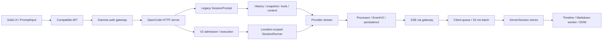

# Gamma: аудит производительности и отзывчивости

Дата: 12 октября 2026. Реализация, production-конфигурация, permissions и механизмы OpenCode не изменялись. Отдельное расследование новых визуальных симптомов: [GAMMA_FRONTEND_INCIDENT.md](GAMMA_FRONTEND_INCIDENT.md).

## 1. Executive Summary

Обнаружены разные классы проблем, которые нельзя объединять в «медленная LLM»:

1. **Воспроизведён дефект восстановления frontend после потери SSE-события.** Обновлённый persisted ответ не появляется после reconnect; reload его показывает. Это реальная проблема корректности клиентской синхронизации, способная выглядеть как неограниченное ожидание ответа.
2. **Воспроизведено практически нечитаемое содержимое в dark mode.** Gamma light-only CSS конфликтует с dark tokens OpenCode. Ответ может уже быть в DOM, но пользователь его почти не видит. Подробные RGB/скриншоты — в frontend incident report.
3. **Есть подтверждённые кодом дополнительные стадии до provider:** создание сессии/route transition на frontend, загрузка всей legacy истории, snapshot для Git workspace, подготовка tools/skills/MCP/context. Для них нет production duration. Snapshot lock общий для одного snapshot gitdir, поэтому разные сессии могут конкурировать на этой стадии.
4. **Есть синхронная работа в backend event loop:** gzip/deflate для больших API-ответов, SQLite statements и сериализация. Реальный ущерб concurrent streams не измерен.
5. **Streaming UI на доступной машине не показал секундных фризов.** На fixtures 2/100/500 сообщений измерены median chunk → DOM 2,00/4,05/9,95 мс. Ноль Long Tasks в коротких streaming-окнах. Virtualization работает: при 500 сообщениях смонтировано 22 timeline rows. Однако реактивная проекция пересматривает всю загруженную историю, а V2 adapter дополнительно нормализует всю историю.

Недостаточно данных, чтобы объявить единственную причину всех production-задержек либо приписать их provider. Нет доступного test/production instance, HAR, реальных backend timestamps и данных пострадавших браузеров. Пользователь подтвердил отсутствие тестового экземпляра. Эти ограничения не мешают воспроизвести CSS/recovery-дефекты, но исключают честное численное разделение production latency по всем стадиям.

## 2. Архитектура обработки запросов

Исследовалось текущее рабочее дерево на базе HEAD `768f18ffe3f35c81bbbd65ee8cae802ef53c35b9`, уже содержавшее множество пользовательских изменений. [Fingerprint исходников](evidence/2026-10-12/source-sha256.json).

Основной UI — SolidJS, не React. Runtime state — Solid stores и TanStack Solid Query, не Zustand. `useEffect/useMemo/useCallback` и React commit count не являются метриками этого frontend; соответствующие точки — `createEffect/createMemo`, reactive invalidation, DOM/layout.

Роли пакетов:

| Область | Код / зависимость |
| --- | --- |
| Browser entry, auth, UI | `packages/app/src/entry.tsx`, `context/gamma-auth.tsx`, `app.tsx` |
| UI components, theme, Markdown | `packages/ui`, `packages/session-ui` |
| Legacy client | workspace `packages/sdk/js/src/v2`; имя SDK v2 не означает V2 session runtime |
| Current client | `packages/app/package.json` использует vendor `@opencode-ai/client` **1.17.13**; это не автоматически текущие исходники `packages/client` |
| Compatibility | `utils/server-protocol.ts`, `utils/server-compat.ts`, `context/server-sdk.tsx` |
| Gateway | `deploy/web.ts`; stream forwarding и session revocation, PTY WebSocket proxy |
| Main backend | `packages/opencode/src/server/routes/instance/httpapi/server.ts` объединяет legacy и current routes |
| Legacy orchestration | `packages/opencode/src/session/{prompt,processor,llm}.ts` |
| Current protocol/server | Schema → Core/Protocol → Server; `packages/core/src/session`, `packages/server/src/handlers` |
| Shared event/storage | `packages/core/src/event.ts`, database; `opencode/src/event-v2-bridge.ts` |

**Выбор протокола принципиален.** `server-protocol.ts:26` сначала проверяет `/global/health`; `{healthy:true}` означает v1. Этот backend возвращает именно такой ответ (`handlers/global.ts:66`). Поэтому штатное сочетание этого frontend и OpenCode server выбирает legacy session route даже при новом V2 layout и наличии `/api/*`. V2 layout, SDK `/v2` и V2 runtime — три разных понятия. Production topology не опрошена; вывод основан на коде и использованном fixture.

Runtime restrictions Schema/Core/Protocol/Server следует сохранить. Client runtime не должен импортировать Core/Server ради локальной «оптимизации» orchestration. UI уже использует некоторые Core utility imports; это не основание переносить серверные сервисы в browser.

## 3. Карта критического пути сообщения

| Стадия | Реальный путь и возможное ожидание | Измеренность |
| --- | --- | --- |
| Нажатие → обработчик | `prompt-input-v2.tsx:402` → `prompt-input/submit.ts:341` | Реальный пользовательский ввод не измерен |
| Подготовка нового чата | `submit.ts:385` worktree при необходимости, `:426` create session, `:443` **await startTransition** перед prompt | Подтверждена последовательность, duration неизвестна |
| Подготовка parts | `submit.ts:100–205`: attachments/context, optimistic state, request | Не измерено на реальных вложениях |
| Worktree readiness | `submit.ts:584–639`, таймаут до 5 минут только для pending worktree | Код; не общее ожидание каждого prompt |
| API dispatch | `server-compat.ts:201` → legacy `session.promptAsync` | Код; initial protocol probe также prerequisite |
| Gamma gateway | `deploy/web.ts:113–147`: auth, fetch loopback, потоковое тело | Продолжительность неизвестна |
| Backend acceptance | `handlers/session.ts:322–342`: session/agent validation, fork prompt, **204** | 204 не означает начало/окончание LLM и не является V2 durable admission |
| Legacy prompt | `session/prompt.ts:1066`: `withUserInput`, revert cleanup, resolve parts, persist user, loop | Код; attachments/plugin могут задержать начало |
| История | `prompt.ts:1120` → `message-v2.ts:578` → `stream(:473)`, все страницы по 50 → filter compaction | Код; не только последние видимые сообщения |
| Pre-provider | `processor.ts:103` snapshot, `prompt.ts:1256` tools, `:1285` plugin transform, `:1287` system/model messages | Код + отдельное измерение bundle validation |
| Provider | `llm.ts:90` лог stream ещё до provider preparation; native/AI SDK dispatch, retries/headers/chunks | Реальный TTFT неизвестен |
| Stream processing | `processor.ts:659–665`: `llm.stream`, tap observe, tap handleEvent, persistence/events | Код; каждый обработчик стоит в consumer path |
| Event delivery | EventV2 → bridge → GlobalBus → `/global/event` → gateway | Реальная сеть не измерена |
| Browser receive | SDK parser → `server-sdk.ts:227–326`, coalesce/batch с 16 ms flush и yield после 8 ms ingestion | Измерено на fixture chunks |
| Store → UI | `server-session.ts:1190`, timeline projection, Markdown worker, sanitizer/morphdom, virtualizer/layout | DOM/RAF/heap/trace измерены |

Для V2 `packages/core/src/session.ts:363–386` сначала durable `SessionInput.admit`, затем advisory `execution.wake`, если `resume !== false`. Process-global execution маршрутизирует Session ID к Location-scoped runner; `runner/llm.ts:254` содержит явный `llm.stream(request)` на turn. Этот путь нельзя диагностировать по latency legacy `prompt_async` или заменять старым loop.

Нужная разметка времени: `click`, `requestStart`, `backendReceived`, `admitted/userPersisted`, `snapshotWaitStart/End`, `contextReady`, `providerDispatch`, `providerHeaders`, `providerFirstMeaningfulDelta`, `eventPublished`, `browserChunkReceived`, `storeApplied`, `DOMUpdated`, `paintOpportunity`. First connected/heartbeat не является first agent response; reasoning/tool/text нужно считать отдельно. Межхостовые timestamps требуют correlation и синхронизации, а не прямого вычитания `Date.now()`.

## 4. Результаты профилирования

### Методика и ограничения

Vite production build выполнен за 17,15 с в отдельный `/tmp`, Sentry upload отключён. Это build duration, не показатель runtime responsiveness. Bun 1.3.14, Linux 6.17, Ryzen 7 9700X. Playwright Chromium, viewport 1366×768 и один mobile case 390×844; CPU throttle 1×. Браузер и backend fixtures изолированы; реальный OpenCode runtime не запускался.

Первый штатный streaming benchmark завершился **ошибкой precondition**, потому что Gamma auth gate оставил страницу на login. Метрики `null`; 30-секундный timeout заголовка нельзя использовать как latency Gamma. Временный harness добавил fake `/auth/session`; исходники приложения не менялись. [Исходный failed log](evidence/2026-10-12/gamma-audit-browser.log).

### Реальный рендеринг на искусственных данных

По одному прогону каждой длины, 20 последовательных marker deltas. Receipt фиксируется в browser TransformStream для SSE body; DOM — MutationObserver; следующий RAF — callback, не фактическое предъявление кадра. Fixture закрывает каждый SSE-response и заставляет клиент переподключаться. Поэтому здесь нельзя измерить реальный production SSE throughput, connection count или network overhead. Сценарий отдельно фиксирует задержку **после получения** marker chunk.

| Метрика | 2 сообщения | 100 сообщений | 500 сообщений |
| --- | ---: | ---: | ---: |
| Setup → заголовок и scroller готовы | 416,92 мс | 412,39 мс | 614,56 мс |
| Chunk → DOM median | 2,00 мс | 4,05 мс | 9,95 мс |
| Chunk → DOM max | 3,00 мс | 5,90 мс | 16,50 мс |
| Chunk → следующий RAF median | 9,60 мс | 12,05 мс | 17,75 мс |
| Chunk → следующий RAF max | 17,30 мс | 20,40 мс | 31,20 мс |
| Long Tasks >50 ms, streaming window | 0 | 0 | 0 |
| Main-thread TaskDuration прирост за серию | 197,79 мс | 257,59 мс | 354,91 мс |
| JSHeapUsedSize после серии | 16,86 MiB | 18,09 MiB | 41,55 MiB |
| Смонтированные timeline rows | 4 | 22 | 22 |
| DOM nodes через querySelectorAll | 748 | 1618 | 1532 |

Setup timing включает работу harness и ожидания Playwright; это не first contentful paint и не переключение сессии. Heap не сравнивался после forced GC, не является retained-memory slope. Main-thread task time — CPU work за окно, не процент CPU. Backend CPU/RSS не измерены, потому что backend не запущен.

**Вывод:** virtualization уже есть и ограничивает DOM. Рост 2→500 сообщений отражается в processing cost и памяти. Нет оснований заявлять, что 500 сообщений обязательно вызывают секундный freeze или что нужно «добавить virtualization с нуля».

### Отдельный Chrome trace

[Полный trace](evidence/2026-10-12/renderer-trace.json.gz), 24 037 events; [summary](evidence/2026-10-12/gamma-audit-trace-summary.json). Отдельный instrumented прогон 500 сообщений, его timings не подменяют baseline.

За полное trace window: FunctionCall 2231 / 352,10 мс суммарно; Layout 174 / 111,54 мс, максимум 21,67 мс; UpdateLayoutTree 216 / 50,43 мс; Paint 112 / 19,91 мс. Эти категории могут вкладываться друг в друга и включают startup, поэтому их нельзя складывать в total latency. Long Task нельзя вывести только из FunctionCall max.

CPU samples через sourcemaps указывают, в частности, на:

- `pages/session.tsx:748` — чтение scroll geometry;
- `ui/src/components/scroll-view.tsx:173` — updateThumb;
- `timeline/message-timeline.tsx:493` — scrollToEnd;
- DOMPurify, Solid cleanup, Shiki Oniguruma worker initialization;
- SDK request preparation, усиленное короткими reconnect fixtures.

Это основания для последующих узких профилей. Нельзя объявлять какую-либо из этих функций главным production bottleneck только по этому trace. Во время visual cold-start проверок были Long Tasks около 56–63 мс; постоянного streaming freeze не обнаружено.

### Реальное read-only измерение backend-функции

Вызвана существующая `AgentCatalog.bundle()` на имеющихся файлах репозитория, по 5 раз, без создания synthetic bundles, сессий и LLM. Она проверяет manifest и читает/хеширует каждый файл. [Raw results](evidence/2026-10-12/gamma-audit-catalog.jsonl).

| Bundle | Файлов | Первый вызов | Медиана следующих 4 |
| --- | ---: | ---: | ---: |
| wildberries-management | 10 | 7,57 мс | 0,93 мс |
| presentation-creation | 13 | 2,25 мс | 1,03 мс |
| bitrix24-development | 31 | 4,90 мс | 2,34 мс |
| 1c-development | 195 | 32,93 мс | 14,39 мс |

Первый вызов не означает гарантированно cold disk: OS page cache не сбрасывался. Отдельный Bun process потреблял RSS около 90–106 MiB; это не RSS сервера. Для 1C 5 проверок использовали 68,31 ms user + 40,23 ms system CPU суммарно. На этой машине данный участок сам по себе не объясняет секунды ожидания; повторения на pre-provider path и медленный storage могут увеличить стоимость.

### Что из требуемых метрик осталось неизвестным

Click → API start; backend request processing; runtime first event; provider dispatch → first meaningful delta; click → первый видимый ответ; активные production SSE/WS; реальный input latency/INP; длительная динамика CPU/RSS/heap — **не измерены**. React commits неприменимы. Их отсутствие не заполнено синтетическими TTFT.

## 5. Найденные bottleneck

Уровни доказательств: **R** — воспроизведён дефект/эффект; **M** — измерена стоимость; **C** — механизм подтверждён кодом, production magnitude неизвестен. Severity учитывает потенциальный ущерб, а не означает доказанное влияние на все инциденты.

### P-01 — High, R/C: Missing-event recovery gap

`handlers/global.ts:16–46`, `server-sync.tsx:531–570`, `global-sync/bootstrap.ts:375–410`, `server-session.ts:836–846`.

Legacy SSE не имеет replay id, reconnect обновляет bootstrap/status без восстановления cached transcript. В browser experiment после обновления API fixture и минимум пяти reconnect history запросов было 0; финальный текст невидим до reload. Больше всего проявляется при потере финальных full-part/message events, part-start или при уходе в background/смене сети. Может выглядеть как сколь угодно долгое ожидание.

Ограничение: stale navigation refresh после 15 секунд (`timeline/model.ts:27–35`) и будущий full-part event могут восстановить состояние. Это не универсальная невозможность восстановления.

Исправление: connection epoch, targeted snapshot resync и event-aware reconciliation. Риск: дубли, потеря deltas между snapshot и применением, повторная отправка prompts. Не использовать runtime resume как замену resync.

### P-02 — High, C: Повторная загрузка всей legacy истории до каждого provider turn

`prompt.ts:1120`, `message-v2.ts:473–492,578–579`. `stream()` собирает **все** страницы по 50, после чего вызывается `filterCompacted`. Следовательно, compaction сокращает model context, но не предотвращает чтение старой истории на этой стадии.

Условия: длинные сессии, большие tool outputs, частые tool turns, несколько агентов на общей БД. Влияние: disk/SQLite allocations/JSON decoding до dispatch, конкуренция с history API. UI pagination не ограничивает runtime history load.

Исправление: индексированная выборка нужного compacted suffix с сохранением original ordering, summary/retained-tail semantics; проверять SQL query plans и bytes decoded. Риск: пропуск signed reasoning, tool-call/result пары, неправильная compaction history. Реальные milliseconds не измерены.

### P-03 — High условно, C: Snapshot лежит до provider и разделяет lock рабочего дерева

`processor.ts:99–103`, `snapshot/index.ts:55–62,165,235–297,318–345`. Создание processor ждёт `snapshot.track()`: excludes, diff-files/ls-files, stat с concurrency 8, stage, write-tree; один semaphore на snapshot gitdir. Параллельные сессии одного workspace могут ждать друг друга.

**Критическое ограничение применимости:** `snapshot/index.ts:167–169` отключает этот путь для `vcs !== git`; Gamma `ProductProjects.create()` создаёт директорию без git init. Нельзя считать snapshot причиной каждого нового чата Gamma. Git/submodule/large dirty workspace — обязательное условие проверки.

Исправление: instrumentation lock wait отдельно от git work; reuse/incremental index и безопасная координация неизменившейся revision. Capture должен оставаться до tool mutation: существующий комментарий объясняет race AI SDK tools. Нельзя просто перенести snapshot после stream или выключить snapshots. Риск — сломанный diff/revert и потеря исходного состояния.

### P-04 — High условно, C: Синхронное сжатие/БД разделяют event loop со streams

`httpapi/middleware/compression.ts:57`, подключение `server.ts:317`: `gzipSync/deflateSync` для buffered compressible responses >1024 B. SSE/stream bodies исключены, но большой параллельный history/config/file response блокирует тот же JS event loop. `core/src/database/sqlite.bun.ts:61–70` исполняет `statement.all()` синхронно; Effect wrapper сам по себе не переносит работу в worker.

Исправление: async compression/worker либо измеренно обоснованное сжатие на proxy; меньшие payload/page sizes и SQL планы. Не переносить SQLite целиком между потоками без согласования транзакций. Риски: Accept-Encoding/content-length/stream cancellation, CPU saturation worker pool. Нет production measurement, поэтому не утверждается, что этот участок уже создаёт большие stalls.

### P-05 — Medium, C/M: Streaming инвалидирует проекцию всей загруженной истории

`timeline/projection.ts:32`, `rows.ts:35,152`, `message-part.tsx:711`. `renderable()` читает `.text.trim()` внутри общего memo; delta меняет text, перестраиваются turns/groups/rows по loaded history. `row-reconciliation.ts:7` стабилизирует identities и предотвращает часть DOM remounts, но выполняется после вычисления новых rows.

Для current V2 `server-session.ts:883–920` вызывает normalizeSessionMessages по всем `reduction.messages`, а reducer обновляет массивы. Это дополнительная full-history работа, **не активная ветвь legacy fixture**.

Измерен рост receipt→DOM на 500 сообщениях; причинная доля projection отдельно не изолирована. Исправление: отделить structural topology от текстовых deltas, per-turn projection и нормализация touched message; сохранить keys, history prepend, compaction, shell synthetic messages и interruption dividers. Риск: subtle missing/reordered rows. Просто `memo` вокруг уже memoized компонента не решает invalidation graph.

### P-06 — Medium, C: Файловая панель и preview регулярно перечитывают filesystem

`workspace-files.tsx:83–127,206–214,243–300`: preview каждые 10 s при visible document, на focus и completion; открытое дерево busy workspace обновляется каждые 3 s, recursively expanded directories; открытый файл `force:true` после refresh. Один in-flight update и флаг updateAgain ограничивают перекрытие, но не число чтений. Polling active проверяет все известные session statuses.

`httpapi/site-preview.ts:129–137` вызывает `discover` даже при `enabled:false`; `site-preview.ts:18–68` рекурсивно сканирует до depth 6, 2000 entries/50 apps. Для каждого каталога `ProductProjects.files` снова открывает безопасную цепочку directory handles. Это bounded, но повторяющаяся I/O-нагрузка. File-tree polling в отличие от preview не проверяет `document.visibilityState` в callback.

Исправление: revision-aware discovery cache на workspace, watcher invalidation плюс fallback polling, общий scheduler/refcounts для нескольких tabs, условные file reads по версии, backpressure. Сохранить файловые функции и fallback для non-Git проектов. Риск: stale generated files/site list, удаление/rename, watcher unavailable. Нет реального file-panel latency measurement; fixture с отсутствующим Gamma file API его не заменяет.

### P-07 — Medium, C/M: Повторная подготовка и проверка market skills

`skill/index.ts:301–328,353`, `core/src/skill-market.ts:123–150`, `core/src/agent-market/catalog.ts:47–78`. `Skill.current()` повторно получает sources и читает SKILL-файлы; bundle() читает/хеширует весь bundle, затем `sys.skills()` включается в pre-provider context (`session/system.ts:115`, `prompt.ts:1287`). Cache discovered local skills не равен cache market sources.

Фактическая bundle validation 1C: 14–33 мс в этом окружении; считать её секундным bottleneck оснований нет. Исправление: кеш по immutable validated revision с invalidate при публикации/изменении, сохраняя integrity checks и pin semantics. Риск: stale/подменённые файлы, некорректное обновление dependency bundle. Нельзя удалить проверки целостности ради ускорения.

### P-08 — Medium, C: Новый prompt ждёт не только API/LLM

`submit.ts:426–456` ждёт session creation и route transition, только затем отправляет prompt; для нового worktree существует отдельный readiness wait до 5 min (`:617`). Protocol detection сначала serial probes до 5 s каждый (`server-protocol.ts:14,26–35`). Очередь follow-up может быть намеренной: `submit.ts:505` передаёт draft в UI queue, не отправляя немедленно.

Исправление: separate durable admission от navigation/paint там, где это разрешает контракт, instant optimistic acknowledgement с понятной стадией, cached protocol capability. Риск: phantom session/prompt и потеря draft при ошибке. Нельзя считать любой queue wait багом: delivery mode должен сохраняться.

### P-09 — Medium, C: Длительные provider budgets разрешают настоящее ожидание в минуты

`provider/provider.ts:96–114`: default header/chunk timeout 300 000 ms. `core/session/provider-wait.ts:10`: 6 min normal / 12 min reasoning до meaningful progress, включая retry/backoff. `session/retry.ts:26–31,191–200`: до 5 retry, exponential backoff и Retry-After; status retry публикуется. AI SDK `maxRetries` по умолчанию 0 (`llm.ts:329`), поэтому нельзя без проверки заявлять двойные автоматические retry на этом пути.

Это политика устойчивости, не само по себе доказанный дефект provider. Проблема восприятия усиливается невидимым текстом/status и потерей SSE. Нужны timestamps каждой попытки. Улучшение: диагностируемые стадии ожидания и понятный cancel, измеренные per-provider budgets без произвольного отключения retries. Риск: преждевременный обрыв legitimately long reasoning и повторное платное выполнение.

## 6. Корневые причины задержек

**Подтверждённый механизм недоставленного ответа:** frontend считает reconnect достаточным восстановлением канала, но authoritative transcript не сверяет. Соединение восстановлено, состояние — нет. Отсюда зависимость от сети и кеша конкретного клиента.

**Подтверждённый механизм невидимого ответа:** несогласованные темы делают уже применённый текст нечитаемым. Это visual latency perception, а не TTFT или network loss.

**Подтверждённая архитектурная стоимость, пока без production attribution:** до provider выполняется много работы; history materialization и некоторые filesystem операции повторяются по turn, синхронные операции разделяют event loop, frontend projection масштабируется с loaded history. Их влияние зависит от размера, Git state, agents/tools, storage и клиента.

Не обнаружено доказательств одной глобальной блокировки, сериализующей все agent sessions на время генерации. `AgentMarket.withRun` захватывает directory lock для счётчика, не держит его на весь run (`agent-market.ts:89–98`). Legacy run state и V2 coordinator разделяют Session IDs; конкретные ресурсы — snapshot/БД/process CPU — остаются общими. Не путать per-session serialization с глобальной очередью всех пользователей.

Также не подтверждены общая утечка listeners и полная перезагрузка UI на каждом delta. Есть cleanup, batching, reconciliation, history pagination, 40-session cache, 16-entry timeline cache, 200-entry Markdown cache, отдельные workers и latest-per-key worker queue. Эти механизмы надо сохранить. Count-based cache всё ещё может хранить много bytes; soak measurement отсутствует.

## 7. Таблица проблем с приоритетами

| ID | Приоритет | Доказательство | Где сильнее проявляется | Ожидаемый эффект исправления |
| --- | --- | --- | --- | --- |
| F-01 | Critical | Browser R, RGB/hit-test | Dark/system-dark/custom palette | Возвращает читаемость ввода/ответов и навигации |
| P-01 | High | Browser R + code | Disconnect перед final, stale cache | Убирает ожидание отсутствующего UI update после reconnect |
| P-02 | High | C | Длинная история, много turns/tools | Уменьшает pre-provider I/O/CPU |
| P-03 | High условно | C | Git + большой dirty workspace + concurrent runs | Снижает snapshot work/wait, не теряя recovery semantics |
| P-04 | High условно | C | Большие API payloads одновременно со stream | Снижает shared event-loop stalls |
| P-05 | Medium | C + aggregate UI M | Длинная загруженная история / V2 projection | Более стабильное streaming/input CPU |
| P-06 | Medium | C | Открытое expanded tree/file, many tabs, generated sites | Меньше повторного I/O и запросов |
| P-07 | Medium | C + direct function M | Skill-heavy agents, 1C bundle | Уменьшает повторную context preparation |
| P-08 | Medium | C | Новый чат/worktree, cold protocol | Меньше dispatch delay, яснее pending state |
| P-09 | Medium / диагностика | C | Provider timeout/429/long reasoning | Понятное ожидание и точная атрибуция |
| F-03 | Medium | Failed harness R | Штатные performance tests Gamma | Возвращает полезность CI/benchmarks |
| Asset/cache/version hypotheses | Low до данных | C, без incident R | Старые открытые tabs после deploy | Быстрее диагностика chunk failures |

Для критического backend stall нет подтверждённых production чисел; искусственно назначать Critical всем синхронным операциям неправильно.

## 8. План оптимизации по этапам

| Этап | Работа | Сложность | Риск / критерий результата |
| --- | --- | --- | --- |
| 0 | Исправить F-01 и production visual matrix; добавить release/theme diagnostic snapshot | M | Контраст всех основных состояний и custom theme, без отключения dark |
| 1 | Instrument critical path, connection epoch/queue counters; привести auth/product fixtures в соответствие Gamma | S–M | Не логировать prompts/secrets, измерить overhead; отдельные pre-provider/provider/display histograms |
| 2 | Targeted recovery P-01 | M–L | Final-event loss test проходит без reload, retries prompt отсутствуют, merge race tests зелёные |
| 3 | Измерить history/snapshot/SQLite/compression на реальном workload, затем оптимизировать P-02/03/04 | L | Сохранены compaction/signed history, snapshot-before-tool, transactional consistency |
| 4 | Incremental projection P-05 и coordinated scroll reads/writes по trace | M–L | Сопоставимый production benchmark до/после, нет пропавших строк и scroll jumps |
| 5 | Revision caches для discovery/skills/files | M | Invalidation при rename/delete/config/revision, fallback watcher работает |
| 6 | Multi-agent/long-running browser+backend soak | M | Нет растущих queues/heap/listeners; input/paint latency стабильна при stream |

Целевой эффект указан качественно: обещать «в 10 раз быстрее» без production baseline невозможно. Предлагаемые бюджеты обсуждать после распределений p50/p95/p99, отдельно cold/warm и platform. Optimistic user echo, admission acknowledgement, first reasoning и first text должны быть разными метриками.

## 9. Риски и регрессионные сценарии

| Сценарий из задания | Что действительно выполнено | Осталось |
| --- | --- | --- |
| Новый пустой чат | Статический разбор create/transition/prompt; short fixture содержит 1 user + 1 assistant | Реальная отправка из пустого чата, admission и TTFT |
| Длинный диалог 100–500 сообщений | Production UI с 100 и 500 fixture messages | Реальная DB/history payloads и mixed media |
| Active streaming | 20 последовательных marker deltas на каждом размере | Реальный provider cadence, burst, reasoning/tool transitions |
| Быстрое переключение сессий/проектов | Разобраны cache/prefetch/stale refresh и cleanup | Полный benchmark rapid A→B→A не выполнен |
| Несколько агентов | Разобраны Session coordination/shared resources | Concurrent runtime load test не выполнен |
| Файловая панель во время генерации | Панель присутствует в UI fixture; polling path разобран | Реальный filesystem API и большие файлы не профилированы |
| Долгая работа без reload | Проверены ограничения кешей/cleanup по коду | Часовой soak/retained heap отсутствует |
| Ошибка связи/reconnect | Controlled missed-final-event reproduction, reload control | Реальный proxy/mobile network, stalled-open TCP, background tab |

Обязательные регрессии после будущих изменений: disconnect перед user/assistant/part creation, duplicate/reordered deltas, snapshot + live event race, optimistic message exact retry, queue vs steer, cancellation/retry, permission/question recovery, scroll up while streaming, history prepend, compaction/shell/child sessions, code blocks и image attachments, resize/zoom/mobile keyboard, migration theme/layout и старый tab после deploy. Не менять настройки агентов, permissions, snapshots или инструменты для облегчения нагрузки.

## 10. Какие дополнительные измерения необходимы

1. Browser HAR + console + trace в реальном инциденте с release ID, protocol kind, effective theme, viewport и Session ID; sanitize secrets и содержимое.
2. Backend spans: request handling отдельно от asynchronous execution; user admission/persist, history rows/bytes, snapshot queue/work, MCP/tools/skills/context, provider dispatch/headers/meaningful delta, retries/backoff. `llm.ts` лог `stream` ещё не является timestamp сетевого dispatch.
3. Event path: provider event timestamp → persistence/publish → gateway body write → browser receive → batch flush/store → DOM/paint; queue depth, event count/bytes, per-session fairness.
4. Browser real long tasks/INP, CPU attribution с sourcemaps, JS heap после GC и worker memory; CSS contrast/visibility вместе с readiness.
5. Backend event-loop delay/utilization, CPU/RSS, SQLite latency/query plans, compression input bytes/work duration, snapshot wait time; p50/p95/p99 по workloads.
6. Число SSE на tab/server и PTY WS отдельно. Код содержит guard одного started stream на Server SDK, server contexts создаются по server key. Это не подтверждает отсутствие лишних connections в deployed clients. Проверить DevTools Network и server connection IDs.
7. Собрать request count/bytes file polling, preview discovery и skills validation; повторить с закрытой/открытой панелью и несколькими tabs, не отключая функциональность.
8. Cross-browser/light-dark/old-new-profile матрица и network shaping на staging. Фактический nginx/cache/HTTP version и old asset availability должны проверяться отдельно от примера deploy-конфига.

### Почему Gamma иногда долго отвечает? Три наиболее вероятных источника максимального ожидания

**Окончательный production ranking пока невозможен.** По способности объяснить именно большой, непостоянный промежуток до видимого ответа приоритет расследования такой:

1. **Потеря синхронизации после SSE reconnect.** Дефект реально воспроизведён: ответ доступен через API, UI его не восстанавливает до reload. Это самый сильный полученный факт о «молчании» интерфейса. Dark CSS дополнительно может скрыть уже показанный ответ — тоже воспроизведено.
2. **Долгое ожидание provider/transport и retries.** Таймауты до минут подтверждены кодом; конкретный медленный provider request не наблюдался. Это вероятный источник большой величины задержки, но объявлять provider виновным без dispatch/first-delta timestamps нельзя.
3. **Gamma/OpenCode pre-provider work и shared resources:** полная materialization истории, Git snapshot/lock при применимости, tools/context/skills, синхронные SQLite/compression. Механизмы подтверждены; bundle validation измерена и локально невелика. Ни один из них пока не доказан как источник многосекундного production incident.

Задержка отображения уже полученного chunk в проверенных условиях измеряется единицами–десятками миллисекунд, не секундами. Поэтому план начинается с подтверждённой читаемости и восстановления состояния, затем — с инструментирования реального критического пути, а не с общего «оптимизировать React».
