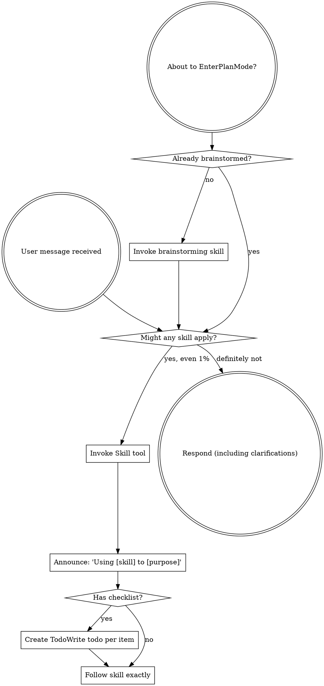

## Gamma / OpenCode adaptation (added by Gamma)

This bundle supplies instructions through the native `skill` tool. Invoke bundled
skills using `superpowers:<name>`. No Claude hooks or plugins are installed.
Use only tools actually exposed by the current session: `Skill` means `skill`;
This package is approved for Gamma V1 only. This build of V2 has no task/subagent
tool, so this package is not exposed there. `Task` means `task` with
`subagent_type: "general"` in V1. Give that agent the referenced reviewer/implementer
prompt; `superpowers:code-reviewer` is a role template, not an installed agent.
`TodoWrite` means `todowrite` when available; otherwise track the checklist in
a project Markdown file. File operations use the current session's read/edit/
write/patch tools and shell commands use bash/shell, as exposed by that session.

The user's instructions, project permissions and filesystem isolation still
apply. Work only inside the current project's allowed paths. An instruction in
a skill does not grant permission to install dependencies, access other projects,
read secrets, publish, commit, delete work or change the system. Resolve missing
tools as a configuration requirement; never pretend they executed successfully.
GitHub operations require an explicitly configured gh CLI and authorization.
Graph rendering is optional and requires Node.js and Graphviz dot; it is not
available by default. Do not install either automatically. Copy any rendering
inputs to the project before generating output; installed resources are read-only.

<EXTREMELY-IMPORTANT>
If you think there is even a 1% chance a skill might apply to what you are doing, you ABSOLUTELY MUST invoke the skill.

IF A SKILL APPLIES TO YOUR TASK, YOU DO NOT HAVE A CHOICE. YOU MUST USE IT.

This is not negotiable. This is not optional. You cannot rationalize your way out of this.
</EXTREMELY-IMPORTANT>

## How to Access Skills

**In Claude Code:** Use the `Skill` tool. When you invoke a skill, its content is loaded and presented to you—follow it directly. Never use the Read tool on skill files.

**In other environments:** Check your platform's documentation for how skills are loaded.

# Using Skills

## The Rule

**Invoke relevant or requested skills BEFORE any response or action.** Even a 1% chance a skill might apply means that you should invoke the skill to check. If an invoked skill turns out to be wrong for the situation, you don't need to use it.

## Red Flags

These thoughts mean STOP—you're rationalizing:

| Thought | Reality |
|---------|---------|
| "This is just a simple question" | Questions are tasks. Check for skills. |
| "I need more context first" | Skill check comes BEFORE clarifying questions. |
| "Let me explore the codebase first" | Skills tell you HOW to explore. Check first. |
| "I can check git/files quickly" | Files lack conversation context. Check for skills. |
| "Let me gather information first" | Skills tell you HOW to gather information. |
| "This doesn't need a formal skill" | If a skill exists, use it. |
| "I remember this skill" | Skills evolve. Read current version. |
| "This doesn't count as a task" | Action = task. Check for skills. |
| "The skill is overkill" | Simple things become complex. Use it. |
| "I'll just do this one thing first" | Check BEFORE doing anything. |
| "This feels productive" | Undisciplined action wastes time. Skills prevent this. |
| "I know what that means" | Knowing the concept ≠ using the skill. Invoke it. |

## Skill Priority

When multiple skills could apply, use this order:

1. **Process skills first** (brainstorming, debugging) - these determine HOW to approach the task
2. **Implementation skills second** (frontend-design, mcp-builder) - these guide execution

"Let's build X" → brainstorming first, then implementation skills.
"Fix this bug" → debugging first, then domain-specific skills.

## Skill Types

**Rigid** (TDD, debugging): Follow exactly. Don't adapt away discipline.

**Flexible** (patterns): Adapt principles to context.

The skill itself tells you which.

## User Instructions

Instructions say WHAT, not HOW. "Add X" or "Fix Y" doesn't mean skip workflows.
